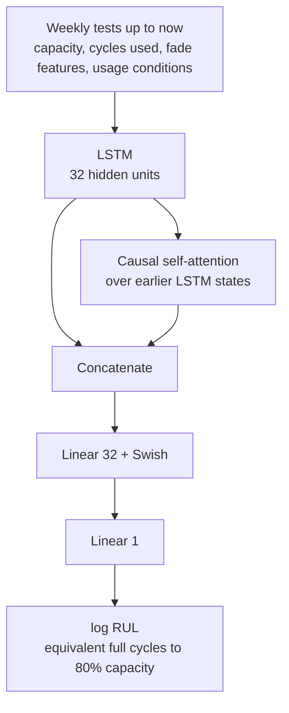
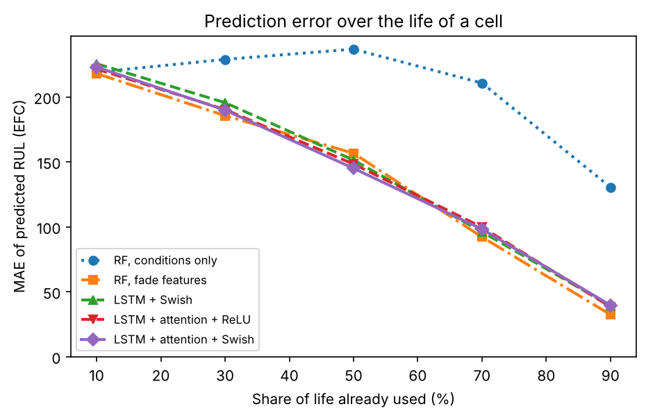
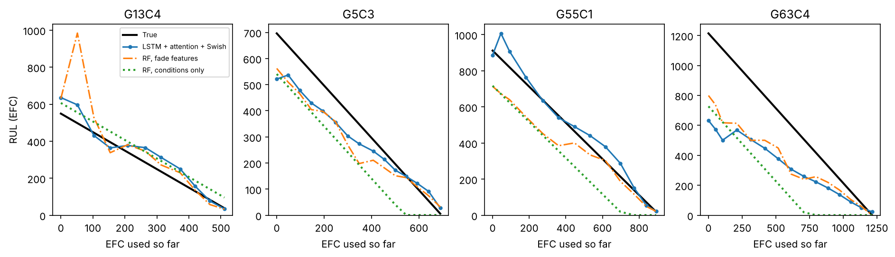
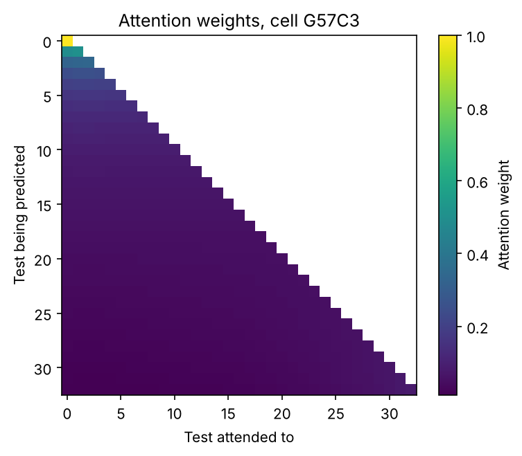

# Battery RUL Prediction with LSTM, Attention and Swish

Final project for MASC 520.

Predicts the remaining useful life (RUL) of a lithium-ion cell from its capacity history so far and its usage conditions. An LSTM reads the weekly capacity tests, an attention layer looks back over earlier tests, and a Swish-activated head outputs the RUL. All models are evaluated on experimental conditions they were never trained on.

## Model

## Results

Mean absolute error of predicted RUL in equivalent full cycles (EFC), five-fold cross-validation by experimental group. Deep models: mean and standard deviation over five random initializations, and the error after averaging the five models.

| Model | MAE | MAE std | Ensemble MAE | Median error |
| --- | --- | --- | --- | --- |
| Random forest, conditions only | 203.0 | | | 40.1% |
| Random forest, fade features | 137.7 | | | 22.7% |
| LSTM + Swish | 149.4 | 3.7 | 142.6 | 25.5% |
| LSTM + attention + ReLU | 147.8 | 5.4 | 140.7 | 24.8% |
| LSTM + attention + Swish | 147.4 | 4.6 | 140.4 | 25.5% |

What the results show:

- **Capacity history matters most.** A model that sees only the usage conditions has an error of 203 EFC. Models that also see the capacity history reach about 140.
- **Attention and Swish make no measurable difference.** The three deep models differ by 2 EFC, less than the spread between random initializations (4 to 5 EFC).
- **The deep models match the random forest but do not beat it.** A five-model LSTM ensemble reaches 140.4 EFC against 137.7 for a random forest on the same inputs.
- **Early predictions are hard for every model.** In the first 20% of life the error is about 220 EFC for all models, because little fade is visible yet.
- **Training procedure mattered more than architecture.** A first version trained on the full batch for a fixed 300 epochs scored 161.7 EFC, and training it longer made it worse. Mini-batches with early stopping on held-out groups brought it to 149.4.

RUL over the life of four held-out cells:

How much history is needed (median error as a share of each cell's total life):

| Weekly tests observed | 1 | 2 | 4 | 6 | 8 | 10 | 12 |
| --- | --- | --- | --- | --- | --- | --- | --- |
| Random forest, conditions only | 17.9% | 17.9% | 17.5% | 16.7% | 16.3% | 14.3% | 13.9% |
| LSTM + attention + Swish | 20.2% | 17.7% | 16.7% | 14.5% | 9.9% | 7.0% | 6.4% |

The LSTM's median error stays at or below 15% of total life from 6 weekly tests, and at or below 10% from 8. With fewer than about 4 tests it is no better than knowing the usage conditions alone.

The attention weights are close to uniform over the history, which is consistent with attention adding little beyond the LSTM state:

## Repository

| Path | Content |
| --- | --- |
| `02_train_models.ipynb` | Main notebook: models, training, evaluation, figures, and a form to predict RUL for your own cell |
| `01_build_dataset.ipynb` | Builds `data/rul_steps.csv` from the raw dataset |
| `data/rul_steps.csv` | Processed dataset: one row per weekly test of each cell |
| `data/README.md` | Column descriptions and data source |
| `figures/` | Figures and result tables written by the main notebook |

## How to run

Open `02_train_models.ipynb` in Google Colab or Jupyter and run all cells. It reads `data/rul_steps.csv` (from this repository if no local copy exists) and takes a few minutes on CPU. Requirements: `numpy`, `pandas`, `matplotlib`, `scikit-learn`, `torch`.

The last section of the notebook predicts RUL for a cell you describe: type its usage conditions and capacity history into the input boxes and press **Predict**.

`01_build_dataset.ipynb` is only needed to rebuild the dataset from the raw files (about 11 GB, see `data/README.md`).

## Data

[ISU-ILCC Battery Aging Dataset](https://doi.org/10.25380/iastate.22582234): 251 lithium-polymer cells cycled at 30 °C under 63 combinations of charge rate, discharge rate and depth of discharge. 245 cells that reached end of life are used. RUL is measured in equivalent full cycles (cumulative discharged capacity divided by rated capacity), because one cycle means very different amounts of use across conditions.

## Method

- **Inputs per weekly test:** capacity, EFC used so far, capacity lost so far, recent fade slope, charge rate, discharge rate, depth of discharge.
- **Target:** log(RUL), with RUL floored at 10 EFC.
- **Validation:** five-fold `GroupKFold` by experimental group, so test cells always come from unseen conditions.
- **Training:** Adam, mini-batches of 32 cells, early stopping on 20% of the training groups.
- **Baselines:** a random forest on the usage conditions only, and a random forest on the same seven inputs as the deep models.

## Limitations

- The training settings were chosen using the same cross-validation folds that produce the reported errors, so the deep-model numbers are slightly optimistic.
- 245 cells and a median of 14 weekly tests per cell is a small dataset for sequence models.
- All cells were tested at 30 °C with fixed currents, so the results may not transfer to real-world use.

## References

- T. Li, Z. Zhou, A. Thelen, D. Howey, C. Hu. [Predicting Battery Lifetime Under Varying Usage Conditions from Early Aging Data](https://doi.org/10.48550/arXiv.2307.08382). Cell Reports Physical Science, 2024.
- A. Thelen, T. Li, J. Liu, C. Tischer, C. Hu. [ISU-ILCC Battery Aging Dataset](https://doi.org/10.25380/iastate.22582234). 2023. CC BY 4.0.
- P. Ramachandran, B. Zoph, Q. V. Le. [Searching for Activation Functions](https://arxiv.org/abs/1710.05941). 2017.
- S. Hochreiter, J. Schmidhuber. Long Short-Term Memory. Neural Computation, 1997.
