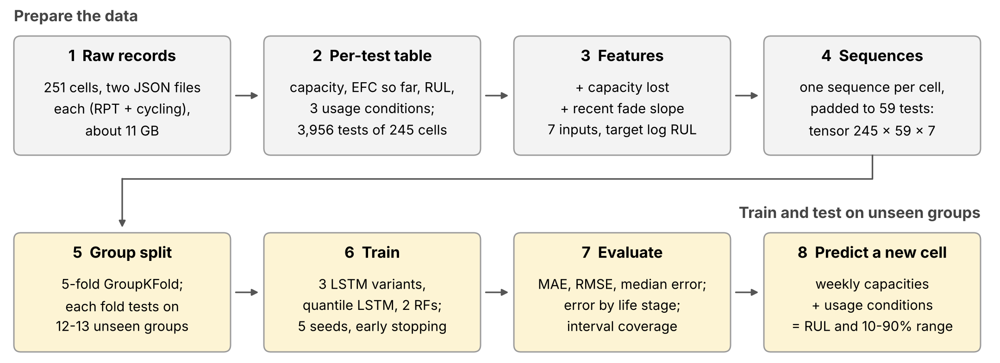
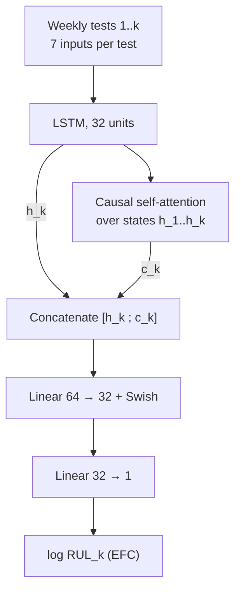
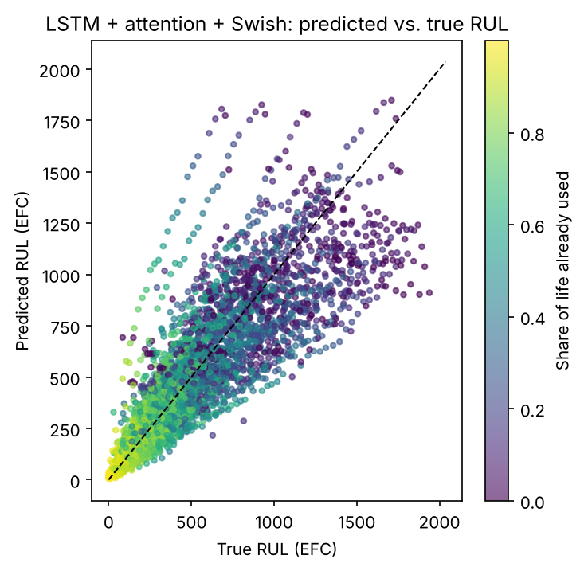

# Remaining Useful Life Prediction of Lithium-Ion Cells under Varying Usage Conditions with LSTM, Attention and Swish

**MASC 520 Final Project**

[Your Name], [Department], [University]

---

## Abstract

How long a battery lasts depends heavily on how it is used, so a lifetime model is only useful if it works for usage patterns it has not seen before. I tested this for remaining useful life (RUL) prediction on the ISU-ILCC dataset, in which 245 lithium-polymer cells were cycled under 63 combinations of charge rate, discharge rate and depth of discharge. From the raw cycling records I built a table of 3,956 weekly capacity tests, each labelled with the RUL in equivalent full cycles (EFC). The main model is an LSTM that reads the tests in order, followed by a causal self-attention layer and a Swish-activated output head. Every model was tested only on experimental groups left out of training. The LSTM reached a mean absolute error of 147.4 EFC, or 140.4 EFC when five training runs were averaged. That is well below the 203.0 EFC of a random forest that only knows the usage conditions, but slightly worse than the 137.7 EFC of a random forest given the same inputs. Removing attention or replacing Swish with ReLU changed the error by less than the variation between training runs, and no model predicted well in the first 20% of a cell's life. To make that uncertainty visible, I also trained a quantile version of the LSTM. Its 10–90% range contained the true RUL for 73% of held-out tests and narrowed from about 665 EFC early in life to 88 EFC near the end, while the spread between training runs covered only 33%.

**Index Terms:** lithium-ion battery, remaining useful life, LSTM, attention, Swish, deep learning

---

## I. Introduction

### A. Why remaining useful life matters

Every charge and discharge wears a lithium-ion battery down a little. Device and car makers define the end of a battery's useful life as a share of its original capacity. Apple, for example, designs the batteries of the iPhone 15 and of MacBooks to keep 80% of their original capacity after 1,000 full charge cycles under ideal conditions, and notes that the real result depends on how the device is used and charged [1]. Electric-vehicle (EV) batteries are usually warranted for at least 8 years and 100,000 miles, with replacement if the capacity falls to about 70% [2]. The remaining useful life (RUL) is how much use is left before that point; this project uses the common lab threshold of 80% of rated capacity. RUL matters to three groups:

- **Owners** of phones, laptops and cars, who have to decide when to replace a battery or the whole device.
- **Manufacturers**, who set warranties and need to know how much a given usage pattern shortens battery life.
- **Second-life users and recyclers**, who buy retired EV batteries for stationary storage. Two used cells with the same capacity can still have very different remaining lives [3], so the capacity alone does not tell what a used battery is worth.

A battery that wears out early also costs more than its price: replacing it means mining, manufacturing and disposal that could have been avoided [4].

### B. Why usage makes RUL hard to predict

How fast a battery fades depends on how it is used. Temperature, state of charge and current all speed up or slow down aging [4]. In a multi-year study at Sandia National Laboratories, cells of the same chemistry, all cycled within the manufacturer's limits, reached 80% capacity thousands of hours and cycles apart, depending only on how they were cycled [5].

The data used in this project shows the same effect (Fig. 1). Cells cycled between 20% and 40% depth of discharge lasted a median of 1,373 equivalent full cycles, against 545 for cells cycled deeper than 80%. Even cells cycled the same way differed: in the median experimental group, the longest-lived cell lasted 1.5 times as long as the shortest-lived one, and in one group 3.1 times as long. A useful RUL model therefore has to take usage into account, and it has to work for usage patterns it has not seen, because no lab can test every way people charge a phone or drive a car.

### C. Starting point

I started this project with my own laptop in mind. Its Windows battery report showed 100.8% of design capacity after 125 cycles, so there was no fade curve to extend. To say anything about its lifetime, I needed a model trained on cells that had already worn out under a range of usage conditions.

### D. Research question and contributions

LSTM networks [6] are the usual tool for RUL prediction, because capacity measurements arrive as a sequence [7], [8]. Most of that work, though, uses the NASA or CALCE datasets, where all cells share one or a few test conditions [9], [10]. A model can do well there simply by recognizing the condition. I wanted to know what happens when it cannot. If the test cells come from conditions absent from training, does an LSTM beat simpler models that get the same information, and do attention and Swish help?

The project makes four contributions:

1. **A per-test RUL dataset** built from the raw ISU-ILCC records: 3,956 capacity tests of 245 cells, each labelled with the RUL in equivalent full cycles and with usage conditions measured from the current records ([`data/rul_steps.csv`](data/rul_steps.csv)).
2. **An LSTM with causal self-attention and a Swish output head**, compared with two random forests, one of which gets exactly the same inputs.
3. **An evaluation on unseen usage conditions**: whole experimental groups are always held out, so no test cell shares its conditions with a training cell.
4. **A prediction range**: a quantile version of the LSTM gives a 10–90% range, and I check how often that range actually contains the true RUL.

## II. Related Work

RUL prediction methods are usually divided into model-based and data-driven approaches [9]. On the data-driven side, Liu *et al.* applied an LSTM to the CALCE datasets [7], and a comparison of a simple RNN, a GRU and an LSTM on the NASA dataset found the LSTM most accurate [8]. Later studies combine the LSTM with other components. Chen *et al.* add an attention mechanism (CA-LSTM) [9], and Tran *et al.* combine 1-D convolution, an attentional LSTM and an ODE-based LSTM [10]. Tran *et al.* also point out that some earlier methods were evaluated on as few as four cells discharged at constant current.

Another line of work predicts lifetime from features measured early in life. Severson *et al.* predicted cycle life from how the discharge voltage curve changed over the first 100 cycles [11]. Li *et al.* created the ISU-ILCC dataset used here, varying charge rate, discharge rate and depth of discharge on purpose, and used it to predict lifetime under varying usage from early aging data [12], [13].

My model follows the common LSTM approach and adds the attention mechanism of [14] and the Swish activation of [15]. What differs is the evaluation: unseen usage conditions, and baselines that receive exactly the same inputs.

## III. Data and Assumptions

### A. Source and test setup

The ISU-ILCC battery aging dataset [13] was collected by Iowa State University (ISU) and Iowa Lakes Community College (ILCC) to study how charge rate, discharge rate and depth of discharge (DoD) affect capacity fade. Li *et al.* used it to predict lifetime from early aging data [12].

- **Cells.** 251 commercial 502030 lithium-polymer pouch cells (Shenzhen Honghaosheng Electronics) with an NMC cathode and a graphite anode, 250 mAh rated capacity and a 3.0–4.2 V operating window.
- **Equipment.** Two 64-channel Neware BTS-4000 battery cyclers, one at each site. The cells were kept in incubators at 30 °C.
- **Cycling.** Each cycle is a constant-current, constant-voltage (CC-CV) charge followed by a constant-current discharge. The discharge stops at a voltage cutoff chosen to give the group's DoD.
- **Reference performance tests (RPTs).** After every 7 days of cycling, each cell went through one full cycle at C/5 and one at C/2. I use the capacity of the C/5 discharge. Groups 20–64 also had an RPT after the first 3.5 days to catch the early fade, and groups 30–64 had pulse tests for internal resistance, which I did not use.
- **End of test.** Cells were cycled until their capacity fell below 80% of the rated value.

### B. Experimental design

Each of the 63 experimental groups has its own charge rate, discharge rate and DoD (Fig. 1a). In groups 1–25 the discharge rate stayed near 0.5C while the charge rate (0.5–3C) and the DoD changed. Groups 26–64 spread all three factors over the whole range. Most groups have four cells; after the exclusions in Section III-C, 58 groups have four cells, four have three and one has one. Table I summarizes the cells used here, and Fig. 2 shows how the capacity of each one faded.

**Table I. Dataset used in this project**

| Item | Value |
| --- | --- |
| Cells / experimental groups | 245 / 63 |
| Cell type | 502030 Li-polymer pouch, NMC / graphite, 250 mAh |
| Test temperature | 30 °C |
| Capacity tests (rows) | 3,956 |
| Tests per cell, median (range) | 14 (2–59) |
| Total life, EFC, median (range) | 784 (85–1,939) |
| Charge rate | 0.50–3.01C |
| Discharge rate | 0.49–2.48C |
| Depth of discharge | 3.5–99.5% |
| Initial capacity, mean | 113.4% of rated |


**Fig. 1.** (a) Charge rate, discharge rate and depth of discharge of the 63 experimental groups. (b) Lifetime of the 245 cells, in equivalent full cycles until the capacity fell to 80% of rated. (c) Lifetime against depth of discharge. The vertical spread at one DoD includes cells of the same group, which were cycled the same way.


**Fig. 2.** Capacity against equivalent full cycles for every cell, colored by depth of discharge. The dashed line marks the end of life (200 mAh). Capacity falls slowly at first and then drops faster after a knee.

### C. Raw files and how I used them

The dataset stores two JSON files for every cell, named by the cell ID (G36C4 is cell 4 of group 36), about 11 GB in total:

- `RPT_json/G#C#.json`: for every RPT, the C/5 and C/2 charge and discharge capacities, the full voltage, current and charge traces, and the start and stop times.
- `Cycling_json/G#C#.json`: for every regular cycle, the charged and discharged capacity, the start and stop times of the charge and discharge steps, and the full current, voltage and charge traces.

The release also contains processed capacity-fade curves, a list of valid cells and a loading script. I did not use the processed curves, because they are indexed by time on test, while I needed the capacity discharged in every cycle to measure usage in equivalent full cycles. I processed the raw files in Google Colab with [`01_build_dataset.ipynb`](01_build_dataset.ipynb), which reduces them to the 0.5 MB table [`data/rul_steps.csv`](data/rul_steps.csv). Table II shows where each column comes from. I excluded six cells that never reached 80% capacity or had missing records.

**Table II. How each column of the table is computed from the raw files**

| Column | Raw source | Computation |
| --- | --- | --- |
| `capacity` | RPT file: C/5 discharge capacity | Taken as is, at every RPT before the end of life |
| `efc_so_far` | Cycling file: discharged capacity and discharge start time of every cycle | Sum over all cycles that started before the RPT, divided by 0.25 Ah |
| `rul_efc`, `efc_total` | `capacity` and `efc_so_far` | End of life interpolated at 200 mAh (Section III-D) |
| `c_chg` | Cycling file: charge current | Maximum current of each of the first 30 charges, median over those cycles, divided by 0.25 A |
| `c_dis` | Cycling file: discharge current | Median current of each of the first 30 discharges, median over those cycles, divided by 0.25 A |
| `dod` | Cycling file: discharged capacity | Median of the first 10 cycles divided by the first RPT capacity |

I computed the usage conditions from the current records instead of copying them from the documentation, so that the same code would also work for a cell whose conditions are not documented. For three cells I checked by hand (G1C1, G26C1, G36C4), the computed values matched the documented conditions.

### D. Labels

A cycle does not mean the same thing across conditions. A cell cycled at 4% DoD ran more than 60,000 cycles, while one at 97% ran a few hundred. I therefore measured usage in *equivalent full cycles* (EFC): the cumulative discharged capacity divided by the rated capacity $Q_r = 0.25$ Ah,

$$
\mathrm{EFC}_k = \frac{1}{Q_r}\sum_{j \in \mathcal{C}_k} q_j
$$

where $\mathcal{C}_k$ is the set of cycles that started before test $k$ and $q_j$ is the capacity discharged in cycle $j$. If test $k$ is the first with capacity $C_k$ below $0.8\,Q_r = 0.2$ Ah, the end of life (EOL) lies between tests $k-1$ and $k$, and I interpolate it:

$$
\mathrm{EFC}_{\mathrm{EOL}} = \mathrm{EFC}_{k-1} + \frac{C_{k-1} - 0.2}{C_{k-1} - C_k}\left(\mathrm{EFC}_k - \mathrm{EFC}_{k-1}\right)
$$

The label at every earlier test is then $\mathrm{RUL}_k = \mathrm{EFC}_{\mathrm{EOL}} - \mathrm{EFC}_k$.

**Worked example.** Table III shows the seven tests of cell G36C4 (charge 2.07C, discharge 0.50C, DoD 93%) before its end of life. The eighth test measured less than 200 mAh, so the end of life lies between the seventh and eighth tests and was interpolated at 284.9 EFC. Each RUL is 284.9 minus the EFC used so far. The second test is closer to the first than the others because of the extra RPT after half a week. The seven rows, with the three conditions repeated on every row, are exactly one input sequence for the LSTM. Capacity lost and fade slope are explained in Section IV-B.

**Table III. The seven capacity tests of cell G36C4**

| Test | Capacity (mAh) | EFC so far | Capacity lost (mAh) | Fade slope (mAh per 100 EFC) | RUL (EFC) |
| --- | --- | --- | --- | --- | --- |
| 1 | 283.3 | 0.0 | 0.0 | 0.0 | 284.9 |
| 2 | 242.5 | 27.1 | 40.8 | 0.0 | 257.9 |
| 3 | 236.9 | 55.4 | 46.4 | −83.7 | 229.5 |
| 4 | 233.2 | 112.1 | 50.1 | −10.9 | 172.8 |
| 5 | 230.6 | 168.2 | 52.7 | −5.6 | 116.8 |
| 6 | 223.6 | 222.9 | 59.7 | −8.7 | 62.0 |
| 7 | 205.6 | 275.2 | 77.7 | −23.4 | 9.7 |


### E. Assumptions

1. **End of life** is the first time the C/5 capacity falls below 80% of rated capacity, a common threshold in battery studies.
2. **Capacity changes linearly** between two weekly tests. This is only used to interpolate the end of life.
3. **Usage conditions are constant** over a cell's life and can be read from its first cycles. This is not strictly true. Discharge ends at a fixed voltage, so an aging cell delivers less per cycle: G1C1 delivered 0.070 Ah in its first cycle but 0.048 Ah at the median. I use the initial DoD because it is known in advance.
4. **Cells in the same group are interchangeable**, so test cells must come from groups that are absent from training.
5. **EFC is the measure of life.** The lab cycled cells continuously, so calendar aging is not captured, and turning EFC into time requires a usage rate.
6. **Missing per-cycle capacities** are filled with the cell's median value.

## IV. Methodology

### A. Pipeline overview

Fig. 3 shows the whole project, from the raw files to a prediction for a new cell. Steps 1–2 are in [`01_build_dataset.ipynb`](01_build_dataset.ipynb) and steps 3–8 in [`02_train_models.ipynb`](02_train_models.ipynb).



**Fig. 3.** Pipeline of the project.

1. **Raw records.** Read the RPT file and the cycling file of each of the 251 cells.
2. **Per-test table.** Make one row per RPT before the end of life, with the capacity, the EFC used so far, the RUL label and the three usage conditions (Section III). Six cells without a usable end of life are dropped, leaving 3,956 rows for 245 cells.
3. **Features.** Add the capacity lost so far and the recent fade slope, giving seven inputs per test. Standardize every input with the mean and standard deviation of the cells used for fitting in the current fold, and take the log of the RUL as the target (Section IV-B).
4. **Sequences.** Turn each cell into one sequence of its tests in time order. Cells have 2 to 59 tests, so the sequences are padded to 59 steps and a mask marks the real ones. The whole input is a 245 × 59 × 7 array. Padded steps are left out of the loss, the attention and the error metrics.
5. **Group split.** Split the 63 groups into five folds with `GroupKFold`. Each fold tests on 12–13 groups (48–50 cells, 710–919 tests) and trains on the rest, and 20% of the training groups are set aside again for early stopping. No group is ever split between training and testing.
6. **Train.** Train three LSTM variants and the quantile LSTM, each with five random seeds in each of the five folds (100 networks), and the two random forests once per fold (Sections IV-C to IV-F).
7. **Evaluate.** Predict the RUL at every test of every held-out cell. At test $k$ the deep models use only tests 1 to $k$. Compute the error metrics, the error by stage of life and the coverage of the prediction ranges (Section IV-G).
8. **Predict a new cell.** The last section of the training notebook retrains the models on all 245 cells and has a form: enter a cell's capacity at each test, the EFC used and its usage conditions, and it returns the predicted RUL with its 10–90% range.

### B. Problem formulation

For cell $i$ with tests $k = 1, \dots, T_i$, the model sees the sequence $\mathbf{x}_{i,1}, \dots, \mathbf{x}_{i,k}$ and predicts $\mathrm{RUL}_{i,k}$. Each test has seven inputs: the measured capacity $C_k$, $\mathrm{EFC}_k$, the capacity lost so far $C_1 - C_k$, the recent fade slope

$$
s_k = \frac{C_k - C_{k-2}}{\mathrm{EFC}_k - \mathrm{EFC}_{k-2}} \quad (s_1 = s_2 = 0)
$$

and the three usage conditions. Inputs are standardized with training statistics. RUL ranges over more than an order of magnitude, so the target is $y_k = \log \max(\mathrm{RUL}_k, 10)$. The floor of 10 keeps the last test before EOL from dominating the loss.

### C. Model

An LSTM with 32 hidden units reads the tests in order, so its state $\mathbf{h}_k$ depends only on tests up to $k$. A single-head self-attention layer [14] then lets each step look back over all earlier states:

$$
\alpha_{kj} = \mathrm{softmax}_{j \le k}\left(\frac{(W_Q\mathbf{h}_k)^{\top} W_K\mathbf{h}_j}{\sqrt{d}}\right), \qquad
\mathbf{c}_k = W_O \sum_{j \le k} \alpha_{kj} W_V \mathbf{h}_j
$$

A causal mask enforces $j \le k$, so no prediction uses future tests. The output head maps the combined state to the log RUL,

$$
\hat{y}_k = \mathbf{w}_2^{\top}\,\mathrm{swish}\left(W_1[\mathbf{h}_k;\mathbf{c}_k] + \mathbf{b}_1\right) + b_2
$$

with $\mathrm{swish}(z) = z\,\sigma(z)$ [15]. Swish is smooth and lets small negative values through, unlike ReLU (Fig. 10). The full model has 11,585 trainable parameters, and 6,337 without attention.

**Fig. 4. Model.** The "LSTM + Swish" variant drops the attention branch, and the "attention + ReLU" variant replaces Swish with ReLU.



### D. Training

The loss is the mean squared error of $\hat{y}_k$ over the real (unpadded) steps. I used Adam [16] with a learning rate of $3\times10^{-3}$, weight decay $10^{-4}$ and mini-batches of 32 cells, and initialized the output bias to the mean target. Training uses early stopping: 20% of the training groups are held out, the validation MAE is checked every two epochs, and training stops after 20 epochs without improvement (120 at most), keeping the best weights. Section V-C explains why this turned out to matter.

### E. Baselines

Two random forests [17] (300 trees, at least two samples per leaf) are trained on the same folds:

- **Conditions only** predicts the log total life from the three usage conditions. The RUL is the predicted total minus $\mathrm{EFC}_k$. This model never sees the cell's capacity.
- **Fade features** gets the same seven inputs as the deep models at each test, but not the sequence. Capacity lost and fade slope give it a summary of the history.

### F. Prediction intervals

A single predicted value says nothing about how far off it might be. I compared two ways of attaching a range to each prediction:

- **Spread of training runs**: the lowest and highest of the five LSTM runs' predictions.
- **Quantile LSTM**: the same network with three outputs instead of one, trained to predict the 10th, 50th and 90th percentiles $\hat{y}^{(\tau)}$ of the log RUL with the pinball loss

$$
L_\tau = \max\left(\tau\,(y - \hat{y}^{(\tau)}),\ (\tau - 1)\,(y - \hat{y}^{(\tau)})\right), \qquad \tau \in \{0.1, 0.5, 0.9\}
$$

Under this loss, predicting too low costs nine times more than predicting too high for $\tau = 0.9$, which pushes that output toward the 90th percentile. The 10–90% range should therefore contain the true RUL 80% of the time. Training, early stopping and folds are the same as for the other deep models, and the five runs' percentiles are averaged. The share of held-out tests whose true RUL falls inside a range is its *coverage*.

### G. Evaluation

All models are evaluated with five-fold `GroupKFold` by experimental group, so every prediction is for a condition the model was not trained on. Each deep model is trained five times from different random seeds. I report MAE and root mean squared error (RMSE) in EFC, and the median relative error $|\hat{r}-r|/r$. The ensemble MAE is the error of the average of the five runs' predictions. I also break the error down by the share of life already used, $\mathrm{EFC}_k / \mathrm{EFC}_{\mathrm{EOL}}$. Three deep variants are compared: LSTM + Swish (no attention), LSTM + attention + ReLU, and LSTM + attention + Swish.

## V. Results

### A. Model comparison

Table IV shows the results. The biggest improvement comes from letting a model see the capacity history at all: the error falls from 203.0 EFC for the conditions-only forest to 137.7–149.4 EFC for the other models. Among those, the random forest on fade features is the most accurate single model. The best deep model, LSTM + attention + Swish, reaches 147.4 EFC, or 140.4 EFC when its five runs are averaged.

**Table IV. RUL prediction error on unseen experimental groups (EFC)**

| Model | MAE | Seed std | Ensemble MAE | RMSE | Median error |
| --- | --- | --- | --- | --- | --- |
| RF, conditions only | 203.0 | – | – | 270.6 | 40.1% |
| RF, fade features | **137.7** | – | – | 211.8 | **22.7%** |
| LSTM + Swish | 149.4 | 3.7 | 142.6 | 227.4 | 25.5% |
| LSTM + attention + ReLU | 147.8 | 5.4 | 140.7 | 225.8 | 24.8% |
| LSTM + attention + Swish | 147.4 | 4.6 | 140.4 | 220.8 | 25.5% |

Deep models: mean over five runs; ensemble = average of the five runs' predictions.

The three deep variants are within 2.0 EFC of each other, while the same model trained from different random seeds varies by 3.7–5.4 EFC. The data cannot tell them apart. Fig. 8 in the appendix plots predicted against true RUL for the best model, and Fig. 7 follows four held-out cells through their life.

### B. Error over the life of a cell

Fig. 5 breaks the error down by how much of its life a cell has already used. In the first 20%, every model is off by 218–226 EFC, and reading the capacity history gives no advantage over knowing the conditions alone. After that, the models that see the history improve steadily, down to 32–40 EFC in the last 20% of life. The conditions-only forest stays around 211–237 EFC until the final stage. Counted in weeks, the LSTM's median error fell below 15% of a cell's total life only after about six weekly tests.


**Fig. 5.** MAE of predicted RUL by the share of life already used. Deep models are shown as five-run ensembles.

### C. Effect of the training procedure

Getting the LSTM to this point took more work on training than on architecture. My first version (LSTM + Swish without attention, five inputs, full-batch training for 300 epochs) scored 159.1 EFC, clearly behind the random forest. I assumed it was undertrained and ran it for 800 epochs with a higher learning rate ($10^{-2}$) and a cosine schedule. The error went up to 199.3 EFC. The model was fitting the training conditions better and the new ones worse.

What helped was close to the opposite of training longer: mini-batches, early stopping on held-out groups, and two extra inputs (capacity lost and fade slope). These changes brought the same architecture to 149.4 EFC. That 9.7 EFC gain is larger than anything attention or Swish produced. Fig. 9 in the appendix shows the validation curves used for early stopping.

### D. Prediction intervals

Table V compares the two ranges. The spread between training runs is narrow and contains the true RUL only 33% of the time: the five runs agree with each other much more than they agree with reality. The quantile LSTM's 10–90% range is wider and contains the true RUL 73% of the time, a little short of the intended 80%. Its width follows the error pattern in Fig. 5, from about 665 EFC in the first 20% of life down to 88 EFC in the last 20%. Its median prediction has an MAE of 141.5 EFC, about the same as the five-run ensemble of the point model.

**Table V. Coverage and median width of the prediction ranges on held-out groups**

| Share of life used | Run spread: coverage | Run spread: width (EFC) | Quantile 10–90%: coverage | Quantile 10–90%: width (EFC) |
| --- | --- | --- | --- | --- |
| All | 32.6% | 106 | 73.2% | 362 |
| 0–20% | 27.6% | 151 | 76.4% | 665 |
| 20–40% | 31.3% | 152 | 74.4% | 493 |
| 40–60% | 34.6% | 134 | 72.6% | 371 |
| 60–80% | 33.6% | 98 | 73.5% | 253 |
| 80–100% | 37.1% | 37 | 68.8% | 88 |

Fig. 6 shows the range for the same four held-out cells as Fig. 7. For three of them the true RUL stays mostly inside the range. G63C4, the cell that outlived its group, stays above the range for most of its life.


**Fig. 6.** Median prediction and 10–90% range of the quantile LSTM for four held-out cells.

## VI. Observations and Discussion

Whether a model reads the capacity history matters far more than which model reads it. All models that saw the history ended up within about 12 EFC of each other, and all of them beat the conditions-only forest by 54–65 EFC.

I think the LSTM did not beat the random forest for two reasons. First, the dataset is small for a sequence model: 245 cells with a median of 14 tests each. Second, the inputs are thin. There is one capacity value per week, and features such as capacity lost and fade slope already summarize the history. The forest gets that summary directly, while the LSTM has to learn it from relatively few examples.

Attention and Swish made no measurable difference. With sequences this short, the LSTM state already carries the history, so looking back over earlier states adds little. And in a network of about 11,000 parameters, the choice between Swish and ReLU in a two-layer head was unlikely to matter much.

The early part of a cell's life is where every model struggles. In the first 20% of life the error is about 220 EFC, close to 28% of the median lifetime of 784 EFC. The fade curves in Fig. 2 show why. Capacity falls slowly at first and then drops sharply after a knee, and in the first few weeks a cell that will last 1,500 EFC looks much like one that will last 500.

Some cells also lived much longer than others in the same group. For G63C4 (Fig. 7), every model predicted only about half to two-thirds of its true RUL early on. Nothing in its usage conditions or early capacity set it apart, and even the quantile range missed it.

The prediction ranges taught me something I had not expected. Training the same model five times looks like a natural way to measure uncertainty, but the runs mostly disagree about details, not about the cases that are actually hard. A range has to be trained for the job, as the quantile LSTM is, and even then it covered 73% instead of 80% on unseen conditions. The early-life range of about 665 EFC is wide, but it is an honest statement of how little the first weeks reveal.

The results also say something to the groups in Section I-A. A warranty is set before any fade has been measured, so a manufacturer is in the position of the conditions-only model, whose error of 203 EFC is about a quarter of the median lifetime. An owner who has checked the capacity only a few times early in life is hardly better off, and should read the prediction range rather than the single number. As more capacity checks come in, the range narrows, from about 665 EFC in the first 20% of life to 88 EFC in the last 20%.

This study has limitations. I chose the training settings using the same folds that produce the reported errors, so the deep-model errors are slightly optimistic. The quantile ranges are also somewhat too narrow for unseen conditions. All cells were small 250 mAh cells tested at 30 °C with fixed currents, which may not carry over to batteries in real devices. Finally, the laptop that started the project could not be evaluated. It has no fade history yet, and its discharge rate (about 0.25C) is below the range of the data.

## VII. Conclusion

On usage conditions it had never seen, the LSTM with attention and Swish cut the error of a conditions-only model by about 27%, from 203.0 to 147.4 EFC. It did not beat a random forest given the same inputs, and neither attention nor Swish made a measurable difference. The results changed with the inputs and the training procedure, not with the architecture. A quantile version of the model gave a range that contained the true RUL 73% of the time, against 33% for the spread between training runs, and made the large early-life uncertainty explicit.

If I continued this work, I would give the sequence model richer inputs, such as the full voltage-capacity curve recorded at each weekly test, which Severson *et al.* found useful early in life [11]. Early life is also where all of the models here were weakest.

## References

[1] Apple Inc., "Battery service and recycling." [Online]. Available: https://www.apple.com/batteries/service-and-recycling/ (accessed Nov. 2026).

[2] NPR, "How long do electric vehicle batteries actually last?," Mar. 2, 2026. [Online]. Available: https://www.npr.org/2026/03/02/nx-s1-5706658/electric-vehicle-battery-lifespan

[3] X. Gu *et al.*, "Challenges and opportunities for second-life batteries: Key technologies and economy," *Renewable and Sustainable Energy Reviews*, vol. 192, 2024, [arXiv:2308.06786](https://arxiv.org/abs/2308.06786).

[4] M. Woody, M. Arbabzadeh, G. M. Lewis, G. A. Keoleian, and A. Stefanopoulou, "Strategies to limit degradation and maximize Li-ion battery service lifetime – Critical review and guidance for stakeholders," *Journal of Energy Storage*, vol. 28, Art. no. 101231, 2020, doi: [10.1016/j.est.2020.101231](https://doi.org/10.1016/j.est.2020.101231).

[5] Y. Preger *et al.*, "Degradation of commercial lithium-ion cells as a function of chemistry and cycling conditions," *Journal of The Electrochemical Society*, vol. 167, no. 12, Art. no. 120532, 2020, doi: [10.1149/1945-7111/abae37](https://doi.org/10.1149/1945-7111/abae37).

[6] S. Hochreiter and J. Schmidhuber, "Long short-term memory," *Neural Computation*, vol. 9, no. 8, pp. 1735–1780, 1997.

[7] Y. Liu, G. Zhao, X. Peng, and C. Hu, "Lithium-ion battery remaining useful life prediction with long short-term memory recurrent neural network," in *Proc. Annu. Conf. PHM Society*, vol. 9, no. 1, 2017, doi: [10.36001/phmconf.2017.v9i1.2447](https://doi.org/10.36001/phmconf.2017.v9i1.2447).

[8] B. Zraibi and M. Mansouri, "Improving lithium-ion battery reliability through neural network remaining useful life prediction," *IAES Int. J. Artif. Intell.*, vol. 14, no. 1, pp. 83–91, 2025, doi: [10.11591/ijai.v14.i1.pp83-91](https://doi.org/10.11591/ijai.v14.i1.pp83-91).

[9] C. Chen, J. Wei, and Z. Li, "Remaining useful life prediction for lithium-ion batteries based on a hybrid deep learning model," *Processes*, vol. 11, no. 8, Art. no. 2333, 2023, doi: [10.3390/pr11082333](https://doi.org/10.3390/pr11082333).

[10] K. Tran, T. Le, B. Huynh, H.-C. Trinh, and V.-R. Nguyen, "End-to-end framework for predicting the remaining useful life of lithium-ion batteries," [arXiv:2505.16664](https://arxiv.org/abs/2505.16664), 2025.

[11] K. A. Severson *et al.*, "Data-driven prediction of battery cycle life before capacity degradation," *Nature Energy*, vol. 4, pp. 383–391, 2019.

[12] T. Li, Z. Zhou, A. Thelen, D. Howey, and C. Hu, "Predicting battery lifetime under varying usage conditions from early aging data," *Cell Reports Physical Science*, 2024, [arXiv:2307.08382](https://arxiv.org/abs/2307.08382).

[13] A. Thelen, T. Li, J. Liu, C. Tischer, and C. Hu, "ISU-ILCC battery aging dataset," Iowa State University, 2023, doi: [10.25380/iastate.22582234](https://doi.org/10.25380/iastate.22582234).

[14] A. Vaswani *et al.*, "Attention is all you need," in *Advances in Neural Information Processing Systems*, vol. 30, 2017.

[15] P. Ramachandran, B. Zoph, and Q. V. Le, "Searching for activation functions," [arXiv:1710.05941](https://arxiv.org/abs/1710.05941), 2017.

[16] D. P. Kingma and J. Ba, "Adam: A method for stochastic optimization," in *Proc. Int. Conf. Learning Representations (ICLR)*, 2015.

[17] L. Breiman, "Random forests," *Machine Learning*, vol. 45, no. 1, pp. 5–32, 2001.

---

## Appendix A. Additional Figures


**Fig. 7.** True and predicted RUL over the life of four held-out cells, chosen across the range of lifetimes.



**Fig. 8.** Predicted against true RUL for the LSTM + attention + Swish ensemble on held-out groups. Color shows the share of life already used.


**Fig. 9.** Validation MAE on the held-out training groups of the first fold during training. Dots mark the epochs kept by early stopping.


**Fig. 10.** The Swish and ReLU activation functions.

## Appendix B. Code

All code is in this repository. [`01_build_dataset.ipynb`](01_build_dataset.ipynb) builds the dataset from the raw records, [`02_train_models.ipynb`](02_train_models.ipynb) trains and evaluates all models, and [`make_data_figures.py`](make_data_figures.py) draws Figs. 1 and 3 from `data/rul_steps.csv`. The excerpts below show the model and the training loop.

### B.1 Model

```python
class RULNet(nn.Module):
    def __init__(self, n_features, hidden=32, attention=True, activation='swish'):
        super().__init__()
        act = nn.SiLU() if activation == 'swish' else nn.ReLU()            # nn.SiLU is Swish
        self.lstm = nn.LSTM(n_features, hidden, batch_first=True)
        self.attention = nn.MultiheadAttention(hidden, num_heads=1, batch_first=True) if attention else None
        self.head = nn.Sequential(nn.Linear(hidden * (2 if attention else 1), 32), act, nn.Linear(32, 1))

    def forward(self, x, padding, return_weights=False):
        states, _ = self.lstm(x)                                           # (cells, steps, hidden)
        weights = None
        if self.attention is not None:
            t = x.shape[1]
            future = torch.triu(torch.ones(t, t, dtype=torch.bool, device=x.device), diagonal=1)
            context, weights = self.attention(states, states, states, attn_mask=future, key_padding_mask=padding)
            states = torch.cat([states, context], dim=-1)                  # current state + attended history
        out = self.head(states).squeeze(-1)                                # log(RUL) at every step
        return (out, weights) if return_weights else out
```

### B.2 Training with early stopping (one fold)

```python
BATCH, LR, MAX_EPOCHS, PATIENCE, CHECK_EVERY = 32, 3e-3, 120, 20, 2

model = RULNet(len(FEATURES), attention=attention, activation=activation)
with torch.no_grad():
    model.head[-1].bias.fill_(float(Y[fit][M[fit]].mean()))         # start at the mean target
optimizer = torch.optim.Adam(model.parameters(), lr=LR, weight_decay=1e-4)

best_error, best_epoch, best_state = np.inf, 0, None
for epoch in range(1, MAX_EPOCHS + 1):
    model.train()
    order = torch.randperm(len(x))
    for start in range(0, len(x), BATCH):
        b = order[start:start + BATCH]
        optimizer.zero_grad()
        loss = ((model(x[b], ~m[b]) - y[b])[m[b]] ** 2).mean()         # padded steps are excluded
        loss.backward()
        optimizer.step()
    if epoch % CHECK_EVERY == 0:                                       # validate on held-out training groups
        model.eval()
        with torch.no_grad():
            pred_val = np.exp(model(x_val, pad_val).numpy())
        error = np.abs(pred_val - RUL[val])[M[val]].mean()
        if error < best_error:
            best_error, best_epoch = error, epoch
            best_state = {k: v.clone() for k, v in model.state_dict().items()}
        elif epoch - best_epoch >= PATIENCE:
            break
model.load_state_dict(best_state)
```

### B.3 Cross-validation by experimental group

```python
cv = GroupKFold(n_splits=5)
FOLDS = list(cv.split(cell_ids, groups=cell_group))   # a group is never split between training and test
```
