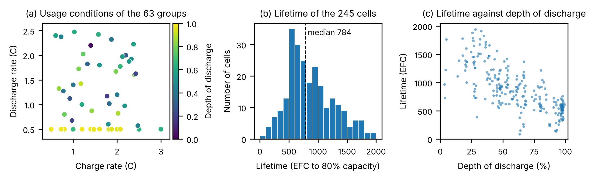
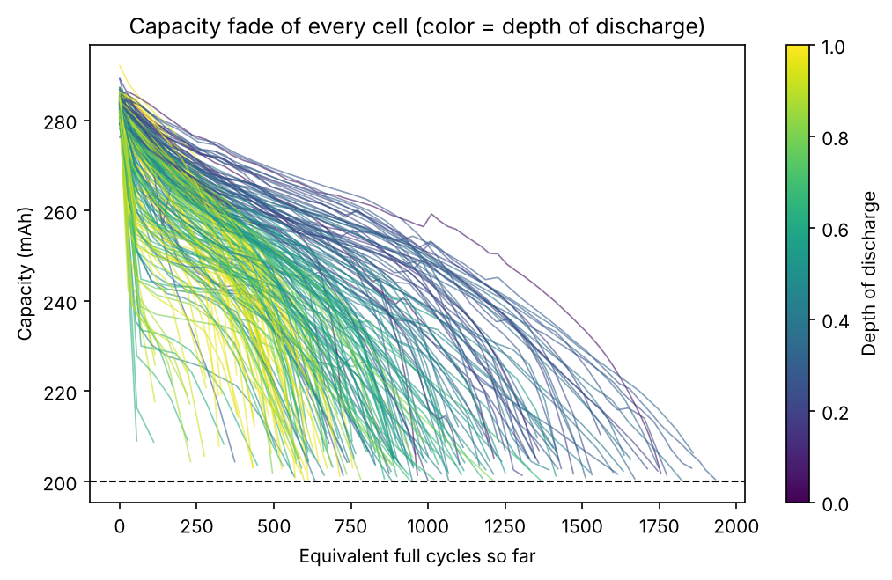
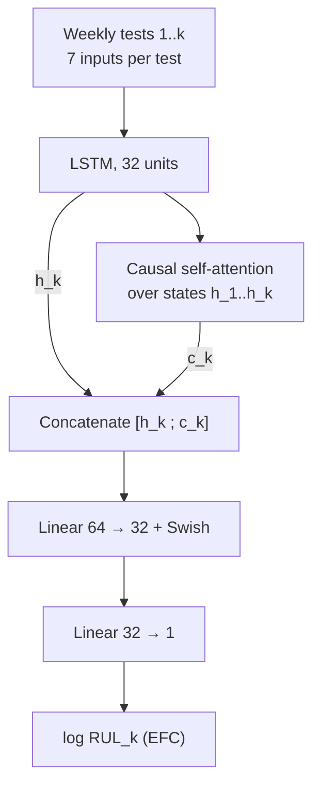
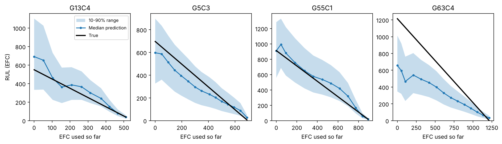
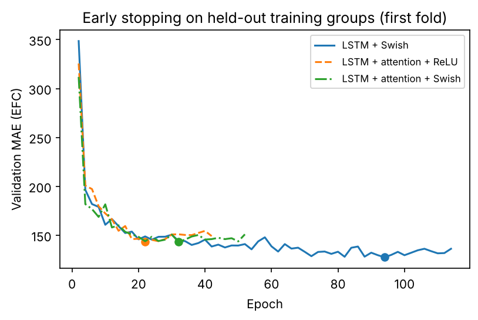
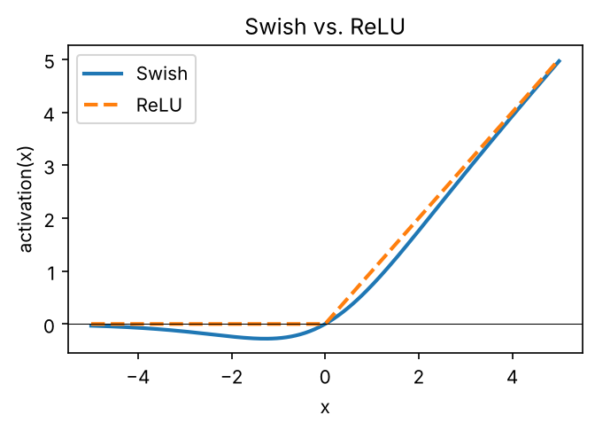
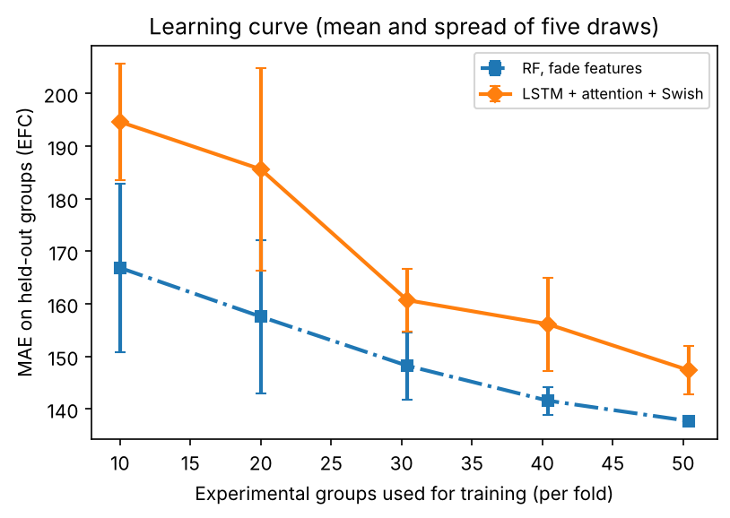

# Remaining Useful Life Prediction of Lithium-Ion Cells under Varying Usage Conditions with LSTM, Attention and Swish

**MASC 520 Final Project**

Junbo Shim, Mork Family Department of Chemical Engineering and Materials Science, University of Southern California

---

## Abstract

Battery lifetime depends on usage, so a lifetime model must generalize to usage conditions not seen in training. This study predicts the remaining useful life (RUL) of 245 lithium-polymer cells from the ISU-ILCC dataset, cycled under 63 combinations of charge rate, discharge rate and depth of discharge, and tests every model only on held-out conditions. An LSTM with causal self-attention and a Swish output head achieved a mean absolute error (MAE) of 147.4 equivalent full cycles (EFC), 27% lower than that of a random forest using only the usage conditions (203.0 EFC) but higher than that of one using the same inputs (137.7 EFC). The three LSTM variants had MAEs within 2.0 EFC of one another. In the first 20% of life, the mean lifetime of other cells tested under the same condition predicted RUL more accurately than any fitted model, and models using the capacity history surpassed this benchmark only after about 40% of life. Split-conformal calibration on held-out training groups raised the coverage of a quantile LSTM's 10–90% interval from 73% to 76%, short of the nominal 80%.

**Index Terms:** lithium-ion battery, remaining useful life, LSTM, attention, Swish, deep learning

---

## I. Introduction

### A. Why remaining useful life matters

Lithium-ion batteries lose capacity with every charge and discharge, and their end of life is commonly defined as a fraction of the original capacity, for example 80% for smartphone and laptop batteries [1] and about 70% under typical electric-vehicle (EV) battery warranties [2]. The remaining useful life (RUL) is the amount of use left before this threshold; this study uses the common laboratory threshold of 80% of rated capacity. Accurate RUL prediction supports replacement decisions by device owners, warranty design by manufacturers and the valuation of retired EV batteries for second-life use, where cells with the same capacity can have very different remaining lives [3].

### B. Why usage makes RUL hard to predict

The rate of capacity fade depends on usage. Temperature, state of charge and current all affect the rate of aging [4]. In a multi-year study at Sandia National Laboratories, cells of the same chemistry cycled within the manufacturer's specifications reached 80% capacity thousands of hours and cycles apart, depending on the cycling conditions [5].

The dataset used in this study shows the same effect (Fig. 1). Cells cycled at 20–40% depth of discharge had a median lifetime of 1,373 equivalent full cycles, compared with 545 for cells cycled beyond 80%. Lifetimes also varied among cells cycled under identical conditions: within the median experimental group, the longest-lived cell lasted 1.5 times as long as the shortest-lived one, and up to 3.1 times as long within a single group. An RUL model must therefore account for usage and generalize to usage patterns absent from the training data, since no test campaign can cover every way batteries are used in practice.

### C. Research question and contributions

Long short-term memory (LSTM) networks [6] are widely used for RUL prediction because capacity measurements form a time series [7], [8]. Most such studies, however, use the NASA or CALCE datasets, in which all cells share one or a few test conditions [9], [10], so a model can perform well simply by recognizing the condition. This study investigates whether an LSTM outperforms simpler models given the same information when the test cells come from usage conditions absent from training, and whether attention and the Swish activation improve its accuracy.

The main contributions of this study are as follows:

1. **A per-test RUL dataset** constructed from the raw ISU-ILCC records: 3,956 capacity tests of 245 cells, each labelled with the RUL in equivalent full cycles and with usage conditions measured from the current records ([`data/rul_steps.csv`](data/rul_steps.csv)).
2. **An LSTM with causal self-attention and a Swish output head**, compared with two random-forest baselines, one of which receives identical inputs.
3. **An evaluation on unseen usage conditions**, in which entire experimental groups are held out, so that no test cell shares its conditions with a training cell.
4. **Diagnostics of the error**: a same-condition benchmark, a feature ablation of the random forest, and split-conformal 10–90% prediction intervals.

## II. Related Work

RUL prediction methods are usually divided into model-based and data-driven approaches [9]. On the data-driven side, Liu *et al.* applied an LSTM to the CALCE datasets [7], and a comparison of a simple RNN, a GRU and an LSTM on the NASA dataset found the LSTM most accurate [8]. Later studies combine the LSTM with other components. Chen *et al.* add an attention mechanism (CA-LSTM) [9], and Tran *et al.* combine 1-D convolution, an attentional LSTM and an ODE-based LSTM [10]. Tran *et al.* also point out that some earlier methods were evaluated on as few as four cells discharged at constant current.

Another line of work predicts lifetime from features measured early in life. Severson *et al.* predicted cycle life from how the discharge voltage curve changed over the first 100 cycles [11]. Li *et al.* created the ISU-ILCC dataset used here, deliberately varying the charge rate, discharge rate and depth of discharge, and used it to predict lifetime under varying usage from early aging data [12], [13].

The model in this study follows the common LSTM approach and adds the attention mechanism of [14] and the Swish activation of [15]. It differs from prior work mainly in its evaluation, which uses unseen usage conditions and baselines that receive identical inputs.

## III. Data and Assumptions

### A. Cells and test conditions

The ISU-ILCC battery aging dataset [13] was collected by Iowa State University (ISU) and Iowa Lakes Community College (ILCC) to study how charge rate, discharge rate and depth of discharge (DoD) affect capacity fade. Li *et al.* used it to predict lifetime from early aging data [12].

- **Cells.** 251 commercial 502030 lithium-polymer pouch cells (Shenzhen Honghaosheng Electronics) with an NMC cathode and a graphite anode, 250 mAh rated capacity and a 3.0–4.2 V operating window.
- **Equipment.** Two 64-channel Neware BTS-4000 battery cyclers, one at each site. The cells were kept in incubators at 30 °C.
- **Cycling.** Each cycle is a constant-current, constant-voltage (CC-CV) charge followed by a constant-current discharge. The discharge stops at a voltage cutoff chosen to give the group's DoD.
- **Reference performance tests (RPTs).** After every 7 days of cycling, each cell underwent one full cycle at C/5 and one at C/2; this study uses the capacity of the C/5 discharge. Groups 20–64 also had an RPT after the first 3.5 days to capture the early fade, and groups 30–64 had pulse tests for internal resistance, which were not used.
- **End of test.** Cells were cycled until their capacity fell below 80% of the rated value.

Each of the 63 experimental groups has its own charge rate, discharge rate and DoD (Fig. 1a). In groups 1–25 the discharge rate was kept near 0.5C while the charge rate (0.5–3C) and the DoD were varied; groups 26–64 varied all three factors over the full range. Most groups have four cells; after the exclusions in Section III-B, 58 groups have four cells, four have three and one has one. Table I summarizes the cells used in this study, and Fig. 2 shows the capacity fade of each cell.

**Table I. Dataset used in this study**

| Item | Value |
| --- | --- |
| Cells / experimental groups | 245 / 63 |
| Cell type | 502030 Li-polymer pouch, NMC / graphite, 250 mAh |
| Test temperature | 30 °C |
| Capacity tests (rows) | 3,956 |
| Tests per cell, median (range) | 14 (2–59) |
| Total life, EFC, median (range) | 784 (85–1,939) |
| Charge rate | 0.50–3.01C |
| Discharge rate | 0.49–2.48C |
| Depth of discharge | 3.5–99.5% |
| Initial capacity, mean | 113.4% of rated |



**Fig. 1.** (a) Charge rate, discharge rate and depth of discharge of the 63 experimental groups. (b) Lifetime of the 245 cells, in equivalent full cycles until the capacity fell to 80% of rated. (c) Lifetime against depth of discharge. The vertical spread at a given DoD includes cells of the same group, which were cycled under identical conditions.



**Fig. 2.** Capacity against equivalent full cycles for every cell, colored by depth of discharge. The dashed line marks the end of life (200 mAh). Capacity falls slowly at first and then drops faster after a knee.

### B. Raw data processing

The dataset stores two JSON files for every cell, named by the cell ID (G36C4 is cell 4 of group 36), about 11 GB in total:

- `RPT_json/G#C#.json`: for every RPT, the C/5 and C/2 charge and discharge capacities, the full voltage, current and charge traces, and the start and stop times.
- `Cycling_json/G#C#.json`: for every regular cycle, the charged and discharged capacity, the start and stop times of the charge and discharge steps, and the full current, voltage and charge traces.

The release also contains processed capacity-fade curves, a list of valid cells and a loading script. The processed curves were not used because they are indexed by time on test, whereas measuring usage in equivalent full cycles requires the capacity discharged in every cycle. The raw files were therefore processed in Google Colab with [`01_build_dataset.ipynb`](01_build_dataset.ipynb), which reduces them to the 0.5 MB table [`data/rul_steps.csv`](data/rul_steps.csv); Table II shows how each column is derived. Six cells that never reached 80% capacity or had incomplete records were excluded. Among the cycles with a recorded start time, no discharge capacity was missing, so no values had to be filled. Five cycles had no start time (one each in G25C4 and G26C1–C4) and were excluded from the EFC count, which changes it by at most 0.6 EFC.

**Table II. How each column of the table is computed from the raw files**

| Column | Raw source | Computation |
| --- | --- | --- |
| `capacity` | RPT file: C/5 discharge capacity | Taken as is, at every RPT before the end of life |
| `efc_so_far` | Cycling file: discharged capacity and discharge start time of every cycle | Sum over all cycles that started before the RPT, divided by 0.25 Ah |
| `rul_efc`, `efc_total` | `capacity` and `efc_so_far` | End of life interpolated at 200 mAh (Section III-C) |
| `c_chg` | Cycling file: charge current | Maximum current of each of the first 30 charges, median over those cycles, divided by 0.25 A |
| `c_dis` | Cycling file: discharge current | Median current of each of the first 30 discharges, median over those cycles, divided by 0.25 A |
| `dod` | Cycling file: discharged capacity | Median of the first 10 cycles divided by the first RPT capacity |

The usage conditions were computed from the current records rather than taken from the documentation, so that the same procedure also applies to cells without documented conditions. Section IV-B compares them with the documented protocol for every cell.

### C. Labels

A cycle does not represent the same amount of use across conditions: a cell cycled at 4% DoD ran more than 60,000 cycles, whereas one at 97% ran a few hundred. Usage is therefore measured in *equivalent full cycles* (EFC): the cumulative discharged capacity divided by the rated capacity $Q_r = 0.25$ Ah,

$$
\mathrm{EFC}_k = \frac{1}{Q_r}\sum_{j \in \mathcal{C}_k} q_j
$$

where $\mathcal{C}_k$ is the set of cycles that started before test $k$ and $q_j$ is the capacity discharged in cycle $j$. If test $k$ is the first with capacity $C_k$ below $0.8\,Q_r = 0.2$ Ah, the end of life (EOL) lies between tests $k-1$ and $k$ and is obtained by linear interpolation:

$$
\mathrm{EFC}_{\mathrm{EOL}} = \mathrm{EFC}_{k-1} + \frac{C_{k-1} - 0.2}{C_{k-1} - C_k}\left(\mathrm{EFC}_k - \mathrm{EFC}_{k-1}\right)
$$

The label at every earlier test is then $\mathrm{RUL}_k = \mathrm{EFC}_{\mathrm{EOL}} - \mathrm{EFC}_k$.

**Worked example.** Table III lists the seven tests of cell G36C4 (charge 2.07C, discharge 0.50C, DoD 93%) before its end of life. The eighth test measured below 200 mAh, so the EOL was interpolated at 284.9 EFC between the seventh and eighth tests, and each RUL equals 284.9 EFC minus the EFC accumulated up to that test. The interval between the first two tests is shorter because of the additional RPT after 3.5 days. Together with the three usage conditions repeated on every row, these seven rows form exactly one input sequence for the LSTM; at test 1 the conditions represent the cycling protocol, which is assumed to be known in advance. The capacity lost, the fade slope and this assumption are detailed in Section IV-B.

**Table III. The seven capacity tests of cell G36C4**

| Test | Capacity (mAh) | EFC so far | Capacity lost (mAh) | Fade slope (mAh per 100 EFC) | RUL (EFC) |
| --- | --- | --- | --- | --- | --- |
| 1 | 283.3 | 0.0 | 0.0 | 0.0 | 284.9 |
| 2 | 242.5 | 27.1 | 40.8 | 0.0 | 257.9 |
| 3 | 236.9 | 55.4 | 46.4 | −83.7 | 229.5 |
| 4 | 233.2 | 112.1 | 50.1 | −10.9 | 172.8 |
| 5 | 230.6 | 168.2 | 52.7 | −5.6 | 116.8 |
| 6 | 223.6 | 222.9 | 59.7 | −8.7 | 62.0 |
| 7 | 205.6 | 275.2 | 77.7 | −23.4 | 9.7 |

### D. Assumptions

The results rest on three assumptions. First, each cell's usage protocol is known before testing and remains constant. In practice, the charge delivered per cycle decreases with aging because discharge terminates at a fixed voltage (G1C1: 0.070 Ah in its first cycle and 0.048 Ah at the median); the initial DoD is therefore used, as it is the value known in advance. Second, cells within a group are interchangeable, which is why test cells are always drawn from groups absent from training. Third, EFC is an adequate measure of life; because the cells were cycled continuously, calendar aging is not captured.

## IV. Methodology

### A. Pipeline overview

Fig. 3 summarizes the workflow from the raw files to the prediction for a new cell. Steps 1–2 are implemented in [`01_build_dataset.ipynb`](01_build_dataset.ipynb) and steps 3–8 in [`02_train_models.ipynb`](02_train_models.ipynb).


**Fig. 3.** Workflow of this study. Gray: data preparation. Yellow: training and testing on experimental groups excluded from training.

1. **Raw records.** Read the RPT file and the cycling file of each of the 251 cells.
2. **Per-test table.** Make one row per RPT before the end of life, with the capacity, the EFC used so far, the RUL label and the three usage conditions (Section III). Six cells without a usable end of life are dropped, leaving 3,956 rows for 245 cells.
3. **Features.** Add the capacity lost so far and the recent fade slope, giving seven inputs per test. Standardize every input with the mean and standard deviation of the cells used for fitting in the current fold, and take the log of the RUL as the target (Section IV-B).
4. **Sequences.** Turn each cell into one sequence of its tests in time order. Cells have 2 to 59 tests, so the sequences are padded to 59 steps and a mask marks the real ones. The whole input is a 245 × 59 × 7 array. Padded steps are left out of the loss, the attention and the error metrics.
5. **Group split.** Split the 63 groups into five folds with `GroupKFold`. Each fold tests on 12–13 groups (48–50 cells, 710–919 tests) and trains on the rest, and 20% of the training groups are set aside again for early stopping. No group is ever split between training and testing.
6. **Train.** Train three LSTM variants and the quantile LSTM, each with five random seeds in each of the five folds (100 networks), and the two random forests once per fold (Sections IV-C to IV-E).
7. **Evaluate.** Predict the RUL at every test of every held-out cell. At test $k$ the deep models use only tests 1 to $k$. Compute the error metrics, the error by stage of life and the coverage of the prediction intervals (Section IV-E).
8. **Predict a new cell.** The last section of the training notebook retrains the models on all 245 cells and provides a form: given a cell's capacity at each test, the EFC used and its usage conditions, it returns the predicted RUL with its 10–90% prediction interval.

### B. Problem formulation

For cell $i$ with tests $k = 1, \dots, T_i$, the model receives the sequence $\mathbf{x}_{i,1}, \dots, \mathbf{x}_{i,k}$ and predicts $\mathrm{RUL}_{i,k}$. Each test has seven inputs: the measured capacity $C_k$, $\mathrm{EFC}_k$, the capacity lost so far $C_1 - C_k$, the recent fade slope

$$
s_k = \frac{C_k - C_{k-2}}{\mathrm{EFC}_k - \mathrm{EFC}_{k-2}} \quad (s_1 = s_2 = 0)
$$

and the three usage conditions. Inputs are standardized with training statistics. RUL ranges over more than an order of magnitude, so the target is $y_k = \log \max(\mathrm{RUL}_k, 10)$. The floor of 10 keeps the last test before EOL from dominating the loss.

*Information at each prediction.* At test $k$ the model uses the capacities and EFC of tests 1 to $k$ and the three usage conditions. The conditions are computed from the cell's first 30 cycles (rates) and first 10 cycles (DoD), which run after the first capacity test, so the results assume that the cycling protocol is known before the test starts. In this dataset each group follows a protocol set in advance: the computed rates match the documented protocol [13] within 0.01C for every cell, and the computed DoD is within 3 percentage points of its group's documented mean DoD for 90% of cells. If the conditions had to be measured on the cell itself, the first valid prediction would come after 30 cycles: at the second test for 84% of cells and at the third for the rest. Section V-A also reports the errors on these 3,671 tests.

### C. Model and training

An LSTM with 32 hidden units processes the tests in order, so its state $\mathbf{h}_k$ depends only on tests up to $k$. A single-head self-attention layer [14] then allows each step to attend to all earlier states:

$$
\alpha_{kj} = \mathrm{softmax}_{j \le k}\left(\frac{(W_Q\mathbf{h}_k)^{\top} W_K\mathbf{h}_j}{\sqrt{d}}\right), \qquad
\mathbf{c}_k = W_O \sum_{j \le k} \alpha_{kj} W_V \mathbf{h}_j
$$

A causal mask enforces $j \le k$, so no prediction uses future tests. The output head maps the combined state to the log RUL,

$$
\hat{y}_k = \mathbf{w}_2^{\top}\,\mathrm{swish}\left(W_1[\mathbf{h}_k;\mathbf{c}_k] + \mathbf{b}_1\right) + b_2
$$

with $\mathrm{swish}(z) = z\,\sigma(z)$ [15]. Unlike ReLU, Swish is smooth and passes small negative values (Fig. 10). The full model has 11,585 trainable parameters, and 6,337 without attention.

**Fig. 4. Model.** The "LSTM + Swish" variant omits the attention branch, and the "attention + ReLU" variant replaces Swish with ReLU.



The loss is the mean squared error of $\hat{y}_k$ over the real (unpadded) steps. The model is trained with Adam [16] at a learning rate of $3\times10^{-3}$ with weight decay $10^{-4}$ and mini-batches of 32 cells, and the output bias is initialized to the mean target. Training uses early stopping: 20% of the training groups are held out, the validation MAE is checked every two epochs, and training stops after 20 epochs without improvement (120 at most), keeping the best weights. The effect of these training choices is examined in Section V-D.

### D. Prediction intervals

A point prediction conveys no information about its uncertainty. Two methods of attaching an interval to each prediction were compared:

- **Spread of training runs**: the interval between the lowest and highest predictions of the five LSTM runs.
- **Quantile LSTM**: the same network with three outputs instead of one, trained to predict the 10th, 50th and 90th percentiles $\hat{y}^{(\tau)}$ of the log RUL with the pinball loss

$$
L_\tau = \max\left(\tau\,(y - \hat{y}^{(\tau)}),\ (\tau - 1)\,(y - \hat{y}^{(\tau)})\right), \qquad \tau \in \{0.1, 0.5, 0.9\}
$$

For $\tau = 0.9$, under-prediction is penalized nine times more heavily than over-prediction, which drives that output toward the 90th percentile. A well-calibrated 10–90% interval therefore contains the true RUL 80% of the time. Training, early stopping and folds are the same as for the other deep models, and the five runs' percentiles are averaged. The share of held-out tests whose true RUL falls inside an interval is its *coverage*.

**Split-conformal calibration.** The quantile interval is widened in log space to $[\hat{y}^{(0.1)}-c,\ \hat{y}^{(0.9)}+c]$ by conformalized quantile regression [17]. Inside each fold, 20% of the training groups are set aside; the quantile LSTM is trained on the rest, and $c$ is the 80th percentile of the scores $\max(\hat{y}^{(0.1)}-y,\ y-\hat{y}^{(0.9)})$ on the set-aside groups, taken separately for five bins of the predicted share of life used, $\mathrm{EFC}_k/(\mathrm{EFC}_k+\hat{r}^{(0.5)}_k)$, which is known at prediction time. The held-out fold is used only for the final evaluation. An earlier version calibrated each fold on the out-of-fold errors of the other folds and reported 78.7% coverage; those errors came from models that had been trained on the evaluated fold, so that figure overstated the coverage.

### E. Evaluation and baselines

All models are evaluated with five-fold `GroupKFold` by experimental group, so every prediction is for a condition the model was not trained on. Each deep model is trained five times from different random seeds. Performance is reported as MAE and root mean squared error (RMSE) in EFC, and as the median relative error $|\hat{r}-r|/r$. Because cells have 2 to 59 tests, the MAE weights long-lived cells more; the cell-averaged MAE, the mean of each cell's MAE, weights every cell equally. The ensemble MAE is the error of the average of the five runs' predictions. The error is also broken down by the share of life already used, $\mathrm{EFC}_k / \mathrm{EFC}_{\mathrm{EOL}}$. Three deep variants are compared: LSTM + Swish (no attention), LSTM + attention + ReLU, and LSTM + attention + Swish.

Two random forests [18] (300 trees, at least two samples per leaf) are trained on the same folds:

- **Conditions only** predicts the log total life from the three usage conditions. The RUL is the predicted total minus $\mathrm{EFC}_k$. This model does not use any capacity measurement of the cell.
- **Fade features** receives the same seven inputs as the deep models at each test, but not the sequence; the capacity lost and fade slope provide a summary of the history.

Further analyses put these errors in context:

- **Line through the last two tests**: extends the recent capacity trend to 200 mAh without any training. Until the capacity starts to fall it uses the conditions-only forest, and its predictions are capped at the largest RUL in the training folds.
- **Same-condition benchmark**: predicts each held-out cell from the mean life of the other cells of its group, information that no deployed model has.
- **Feature ablation**: the inputs of the fade-feature forest are added to the usage conditions one at a time, on the same folds and with the same settings.
- **Learning curve**: the LSTM + attention + Swish and the fade-feature forest retrained on 20–100% of each fold's training groups, with five random subsets per size.
- **Voltage-curve features**: the C/5 discharge curve of every weekly test is interpolated to the discharged capacity $Q(V)$ on 3.40–4.05 V, the range covered by every curve. The change since the first test, $\Delta Q(V) = Q_k(V) - Q_0(V)$, is summarized by its mean, minimum and log variance, as in [11]. Four further features are the C/2-to-C/5 capacity ratio, the voltage and height of the largest $dQ/dV$ peak, and the capacity discharged down to 3.40 V. The fade-feature forest and the LSTM + attention + Swish are retrained with these inputs on the same folds.

## V. Results

### A. Model comparison

Table IV summarizes the results. The largest improvement comes from giving a model access to the capacity history: the error falls from 203.0 EFC for the conditions-only forest to 137.7–149.4 EFC for the other models. Among the seven-input models, the random forest on fade features is the most accurate single model. The best deep model, LSTM + attention + Swish, achieves an MAE of 147.4 EFC, or 140.4 EFC when the predictions of its five runs are averaged.

**Table IV. RUL prediction error on unseen experimental groups (EFC)**

| Model | MAE | Seed std | Ensemble MAE | Cell-avg MAE | RMSE | Median error |
| --- | --- | --- | --- | --- | --- | --- |
| RF, conditions only | 203.0 | – | – | 178.1 | 270.6 | 40.1% |
| RF, fade features | **137.7** | – | – | **120.7** | **211.8** | **22.7%** |
| LSTM + Swish | 149.4 | 3.7 | 142.6 | 129.2 | 227.4 | 25.5% |
| LSTM + attention + ReLU | 147.8 | 5.4 | 140.7 | 129.0 | 225.8 | 24.8% |
| LSTM + attention + Swish | 147.4 | 4.6 | 140.4 | 130.2 | 220.8 | 25.5% |

Deep models: mean over five runs; ensemble = average of the five runs' predictions; cell-avg = mean of each cell's MAE.

The MAEs of the three deep variants are within 2.0 EFC of one another, whereas the MAE of the same model trained from different random seeds has a standard deviation of 3.7–5.4 EFC. With five runs per variant, the experiment therefore cannot rank the variants. On the 3,671 tests that follow the first 30 cycles, where measured conditions would already be available (Section IV-B), the MAEs are 204.3, 133.9 and 142.9 EFC for the conditions-only forest, the fade-feature forest and the LSTM with attention and Swish (135.8 EFC for its ensemble), the same order as on all tests. Fig. 8 in the appendix plots the predicted against the true RUL for the best model, and Fig. 7 shows the predictions for four held-out cells over their lifetimes. Weighting every cell equally (cell-averaged MAE) lowers all errors, because long-lived cells contribute more tests and larger errors. The fade-feature forest remains the most accurate (120.7 EFC, against 123.1–124.3 EFC for the LSTM ensembles), but the order of the three LSTM variants changes, as expected for differences within seed variation.

The feature ablation (Table V) shows where the forest's advantage comes from. Adding the EFC used to the usage conditions did not help, but adding the current capacity reduced the MAE from 204.7 to 155.3 EFC, about three quarters of the gain to 137.7 EFC. Adding capacity lost (148.4 EFC), fade slope (143.3 EFC) or both (137.7 EFC) supplied the rest, with the largest relative gain in the last 20% of life; no input set improved the first 20% of life.

**Table V. Random-forest feature ablation (MAE in EFC, same folds)**

| Inputs | MAE | Cell-avg MAE | First 20% of life | Last 20% of life |
| --- | --- | --- | --- | --- |
| Conditions only (total life) | 203.0 | 178.1 | 219.0 | 130.5 |
| Conditions + EFC used | 204.7 | 177.4 | 225.3 | 115.1 |
| Conditions + capacity + EFC used | 155.3 | 132.6 | 225.5 | 46.3 |
| Conditions + capacity + EFC used + capacity lost | 148.4 | 128.5 | 218.4 | 42.9 |
| Conditions + capacity + EFC used + fade slope | 143.3 | 123.8 | 226.4 | 32.8 |
| All seven inputs (both added) | **137.7** | **120.7** | 218.0 | **32.4** |

The learning curve (Fig. 11 in the appendix) shows both models still improving with the full training set: with 10, 30 and 50 training groups per fold, the MAE of the LSTM fell from 194.6 to 160.7 to 147.4 EFC and that of the forest from 166.8 to 148.2 to 137.7 EFC, so the gap narrowed from 28 to 10 EFC.

### B. Error over the life of a cell

Fig. 5 breaks the error down by the share of life already used. In the first 20%, all models have errors of 218–226 EFC, and the capacity history provides no advantage over the usage conditions alone. Thereafter, the error of the models that use the history decreases steadily, to 32–40 EFC in the last 20% of life, whereas the conditions-only forest remains at about 211–237 EFC until the final stage. In terms of the number of tests, the median error of the LSTM fell below 15% of a cell's total life only after about six weekly tests.


**Fig. 5.** MAE of predicted RUL by the share of life already used. Deep models are shown as five-run ensembles; the gray line is the same-condition benchmark (mean life of the other cells in the group).

### C. A same-condition benchmark

On the 3,923 tests whose group has another cell, the same-condition benchmark has an MAE of 171.7 EFC, between the conditions-only forest (202.9 EFC) and the fade-feature forest (138.0 EFC). In the first 20% of life, however, it was more accurate than any fitted model (179 vs. 219–223 EFC); the models that use the capacity history matched it at 20–40% of life and surpassed it only after about 40% (Fig. 5). Its error combines the spread between identically cycled cells with the error of estimating a group mean from about three cells, so it is a reference point, not a lower bound on what a model can reach.

The held-out conditions were rarely extrapolations: only 8 of the 63 groups lay outside the training range in any condition, and a group's relative error was not correlated with the distance from its condition to the nearest training condition (Spearman ρ = 0.06–0.20, p ≥ 0.12). The LSTM ensemble was more accurate than the fade-feature forest for cells cycled beyond 40% DoD (114.0 vs. 122.4 EFC at 40–80% and 84.1 vs. 87.9 EFC above 80%) but less accurate for the long-lived cells cycled at most 40% DoD (196.4 vs. 179.1 EFC).

The straight line through the last two tests was far less accurate than either learned model, with an MAE of 396.5 EFC overall and 86.0 EFC in the last 20% of life, against 32.4 and 39.6 EFC. Lines through the last 3, 4 or 6 tests were worse.

### D. Effect of the training procedure

Changes to the training procedure and inputs had a greater effect on prediction accuracy than changes to the architecture. The training procedure was selected by comparing the MAE of 16 configurations on the five test folds: the output floor and bias initialization, the number of epochs, the learning rate and its schedule, full-batch versus mini-batch training, early stopping, the input set, a linear target with the Huber loss, dropout, attention and the activation. The layer sizes (32 hidden LSTM units, one attention head and a 32-unit head) and the forest settings (300 trees, at least two samples per leaf) were fixed beforehand and not tuned. The first version (LSTM + Swish without attention, five inputs, full-batch training for 300 epochs) had an MAE of 159.1 EFC, 21.4 EFC higher than that of the fade-feature forest. Extending training to 800 epochs with a higher learning rate ($10^{-2}$) and a cosine schedule increased the error to 199.3 EFC: the model fitted the training conditions more closely but generalized worse to unseen ones.

Mini-batch training, early stopping on held-out groups and two additional inputs (capacity lost and fade slope) instead reduced the error of the same architecture to 149.4 EFC. This improvement of 9.7 EFC is larger than the differences of at most 2.0 EFC among the architectural variants. Fig. 9 in the appendix shows the validation curves used for early stopping.

### E. Prediction intervals

Table VI compares the interval methods. The spread of training runs is narrow and contains the true RUL only 33% of the time: the five runs agree with one another far more closely than with the observed values. The 10–90% interval of the quantile LSTM is wider and contains the true RUL 73% of the time, short of the nominal 80%. Its width follows the error pattern in Fig. 5, decreasing from about 665 EFC in the first 20% of life to 88 EFC in the last 20%, where its coverage is lowest (68.8%), so the true RUL fell outside the interval for about 31% of those tests. Of these tests, 21% had a true RUL below the interval and 10% above it, so the model overestimated RUL near the end of life. In addition, 6.7% of them had a true RUL below the 10 EFC floor of the training target; flooring those values would raise the coverage to 71.7%.

For split-conformal calibration, a quantile LSTM trained on 80% of each fold's training groups had a raw coverage of 73.2% (median width 386 EFC). Calibration on the remaining groups raised the coverage to 76.2% overall and 71.8% in the last 20% of life, still short of 80%, and the median width by 15%, to 444 EFC. (The 362 EFC width in Table VI belongs to the quantile LSTM trained on all training groups.) Coverage was uneven across groups: its median was 83%, but it stayed below 50% for 8 of the 63 groups. The median prediction of the quantile LSTM has an MAE of 141.5 EFC, comparable to the 140.4 EFC of the five-run ensemble of the point model.

**Table VI. Coverage and median width of the prediction intervals on held-out groups**

| Share of life used | Run spread: coverage | Run spread: width (EFC) | Quantile: coverage | Quantile: width (EFC) | Split-conformal: coverage | Split-conformal: width (EFC) |
| --- | --- | --- | --- | --- | --- | --- |
| All | 32.6% | 106 | 73.2% | 362 | 76.2% | 444 |
| 0–20% | 27.6% | 151 | 76.4% | 665 | 78.2% | 720 |
| 20–40% | 31.3% | 152 | 74.4% | 493 | 79.1% | 599 |
| 40–60% | 34.6% | 134 | 72.6% | 371 | 76.3% | 476 |
| 60–80% | 33.6% | 98 | 73.5% | 253 | 75.7% | 303 |
| 80–100% | 37.1% | 37 | 68.8% | 88 | 71.8% | 101 |

Split-conformal: quantile LSTM refit on 80% of each fold's training groups and calibrated on the other 20% (before calibration: 73.2% coverage, 386 EFC median width).

Fig. 6 shows the intervals for the same four held-out cells as Fig. 7. For three of them the true RUL lies mostly inside the interval; for G63C4, the cell that outlived its group, it lies above the interval for most of its life.



**Fig. 6.** Median prediction and 10–90% prediction interval of the quantile LSTM for four held-out cells.

### F. Features of the voltage curve

Three summaries of the weekly voltage curve improved the forest, but changed its error early in life only slightly (Table VII). Adding the three $\Delta Q(V)$ summaries reduced the forest's MAE from 137.7 to 132.2 EFC. In a bootstrap over the 63 groups, the change was −5.5 EFC (95% interval −10.2 to −1.0 EFC), and 40 of the 63 groups improved. Most of the gain came at 20–60% of life (−13.6 EFC). In the first 20% of life, the change was −3.1 EFC (95% interval −8.6 to +3.4 EFC), and the forest (214.9 EFC) stayed well behind the same-condition benchmark (178.5 EFC). The four other curve features added little. For the LSTM, adding $\Delta Q(V)$ changed the MAE from 147.4 to 145.5 EFC, within the seed-to-seed spread.

The curve carries slightly more information about an individual cell than the capacity does, but not enough. Within groups, the mean of $\Delta Q(V)$ in weeks 2–4 had Spearman correlations of 0.22–0.28 with total life, compared with 0.08–0.17 for the capacity.

**Table VII. Error with features of the voltage curve (MAE in EFC, same folds)**

| Model | MAE | Cell-avg MAE | 0–20% | 20–40% | 40–60% | 60–80% | 80–100% |
| --- | --- | --- | --- | --- | --- | --- | --- |
| RF, seven inputs | 137.7 | 120.7 | 218.0 | 185.6 | 156.6 | 92.1 | **32.4** |
| RF + $\Delta Q(V)$ | 132.2 | 116.1 | 214.9 | **174.7** | **140.4** | 90.0 | 34.2 |
| RF + all curve features | **132.0** | **115.3** | **212.2** | 176.9 | 142.6 | **89.0** | 33.7 |
| LSTM + attention + Swish | 147.4 | 130.2 | 230.9 | 199.3 | 154.1 | 104.8 | 42.2 |
| LSTM + attention + Swish + $\Delta Q(V)$ | 145.5 | 129.1 | 224.5 | 195.0 | 155.6 | 102.1 | 45.6 |
| LSTM + attention + Swish, ensemble | 140.4 | 124.3 | 223.0 | 189.8 | 145.0 | 98.2 | 39.6 |
| LSTM + attention + Swish + $\Delta Q(V)$, ensemble | 138.6 | 123.3 | 216.2 | 186.6 | 147.3 | 95.1 | 42.5 |

Columns 0–20% to 80–100%: share of life already used. Deep models: mean over five runs, or the ensemble of the five runs. Same-condition benchmark in the first 20% of life: 178.5 EFC.

## VI. Observations and Discussion

The comparison with the same-condition benchmark is the most informative result. In the first 20% of life, the lifetimes of sibling cells predicted RUL better than any model that observed the cell's own capacity. Cells cycled identically age differently, and early in life this does not show in the capacity: capacity falls slowly at first and drops sharply after a knee (Fig. 2), so in the first weeks a cell that will last 1,500 EFC resembles one that will last 500 EFC. Knees can arise from several mechanisms, including lithium plating, electrode saturation, resistance growth and electrolyte depletion, some of which build up with little electrochemical signature beforehand [19]. G63C4 (Fig. 7) is an example: neither its usage nor its early capacity distinguished it from its group, and all models predicted only one-half to two-thirds of its true RUL early in life. Summary features of the weekly voltage curve did not close this early-life gap (Section V-F).

The data show associations, not their causes; known degradation mechanisms of NMC/graphite cells suggest possible explanations. Depth of discharge was most strongly associated with lifetime (Spearman ρ = −0.76 across cells). Deeper cycles strain the active particles more, which can crack them and expose fresh surface to SEI growth, so that lithium inventory and active material are lost faster [4]. Among cells cycled above 80% DoD, higher charge rate was associated with shorter life (ρ = −0.30, p = 0.01); lithium plating on graphite at high charging currents, a common cause of knees, is one possible explanation [19]. Faster discharge was associated with longer life in EFC (ρ = +0.39), which may reflect calendar aging, since slowly cycled cells spend more time per EFC at 30 °C, or the design of the test matrix. Near the end of life, the models overestimated RUL (Section V-E), consistent with fade accelerating after a knee. The voltage-curve features reduced the error most at 20–60% of life (Section V-F), possibly because the discharge curve changes measurably only once degradation has progressed.

The feature ablation explains much of the forest's strength: most of its gain over the conditions-only model comes from the current capacity. Both models received this and the other fade summaries (capacity lost and fade slope) directly, and with these inputs the LSTM did not achieve a lower MAE than the forest. The inputs are also sparse, one capacity value per week, and the data are small for a sequence model: 245 sequences with a median of 14 tests. The learning curve is consistent with this data limitation, since the LSTM gained more than the forest from added groups; both were still improving at about 50 groups, however, so whether the LSTM would overtake the forest with more data remains open. The absence of a measurable benefit from attention and Swish is consistent with sequences this short, whose history the LSTM state already carries. The learned models nevertheless add value: extrapolating the capacity trend was two to three times less accurate even in the last 20% of life, where extrapolation should be easiest.

The spread of repeated training runs is a poor measure of uncertainty, because the runs mainly disagree on details rather than on the difficult cases. A trained quantile interval was better, and split-conformal calibration on held-out training groups improved its coverage, but not to the nominal level, likely because ten calibration groups per fold do not represent every held-out condition; tests within a group are also correlated, which the calibration does not model.

These findings have practical implications for the applications in Section I-A. A warranty is set before any fade is observed, which corresponds to the conditions-only model, whose error (203.0 EFC) is about a quarter of the median lifetime of 784 EFC. Predictions based on a few early capacity tests are similarly uncertain and should be read as intervals, and a narrow interval late in life is not a guarantee.

This study has several limitations. The training procedure was chosen on the same folds that produce the reported errors (Section V-D), so the deep-model errors are likely optimistic by an unmeasured amount. The forests were not tuned, so this bias favors the LSTM, and the forest's lead is, if anything, understated. The first prediction of each cell assumes that its usage protocol is known in advance (Section IV-B). Finally, all cells were small 250 mAh cells cycled at 30 °C with constant currents, and the applicability of the model to batteries operating outside these experimental conditions, for example at other temperatures, under dynamic loads or at discharge rates below 0.49C, remains unverified.

## VII. Conclusion

This study evaluated RUL prediction for lithium-ion cells on usage conditions excluded from training. The capacity history reduced the MAE from 203.0 EFC to 137.7–149.4 EFC, in the forest mostly through the current capacity, but the LSTM with attention and Swish did not outperform a random forest given the same inputs, and the effects of attention and Swish were within seed-to-seed variation. In the first 20% of life, the mean lifetime of sibling cells predicted RUL better than any fitted model. Split-conformal calibration raised the coverage of the quantile intervals from 73% to 76%, short of the nominal 80%.

Three $\Delta Q(V)$ summaries of the weekly voltage–capacity curve, a feature that improved early-life prediction in [11], lowered the forest's MAE to 132.2 EFC, but its error in the first 20% of life only from 218.0 to 214.9 EFC, a change within the uncertainty of the estimate. Future work should therefore look for earlier signs of cell-to-cell differences, for example in the cycling data between the weekly tests.

## References

[1] Apple Inc., "Battery service and recycling." [Online]. Available: https://www.apple.com/batteries/service-and-recycling/ (accessed Nov. 2026).

[2] NPR, "How long do electric vehicle batteries actually last?," Mar. 2, 2026. [Online]. Available: https://www.npr.org/2026/03/02/nx-s1-5706658/electric-vehicle-battery-lifespan

[3] X. Gu *et al.*, "Challenges and opportunities for second-life batteries: Key technologies and economy," *Renewable and Sustainable Energy Reviews*, vol. 192, 2024, [arXiv:2308.06786](https://arxiv.org/abs/2308.06786).

[4] M. Woody, M. Arbabzadeh, G. M. Lewis, G. A. Keoleian, and A. Stefanopoulou, "Strategies to limit degradation and maximize Li-ion battery service lifetime – Critical review and guidance for stakeholders," *Journal of Energy Storage*, vol. 28, Art. no. 101231, 2020, doi: [10.1016/j.est.2020.101231](https://doi.org/10.1016/j.est.2020.101231).

[5] Y. Preger *et al.*, "Degradation of commercial lithium-ion cells as a function of chemistry and cycling conditions," *Journal of The Electrochemical Society*, vol. 167, no. 12, Art. no. 120532, 2020, doi: [10.1149/1945-7111/abae37](https://doi.org/10.1149/1945-7111/abae37).

[6] S. Hochreiter and J. Schmidhuber, "Long short-term memory," *Neural Computation*, vol. 9, no. 8, pp. 1735–1780, 1997.

[7] Y. Liu, G. Zhao, X. Peng, and C. Hu, "Lithium-ion battery remaining useful life prediction with long short-term memory recurrent neural network," in *Proc. Annu. Conf. PHM Society*, vol. 9, no. 1, 2017, doi: [10.36001/phmconf.2017.v9i1.2447](https://doi.org/10.36001/phmconf.2017.v9i1.2447).

[8] B. Zraibi and M. Mansouri, "Improving lithium-ion battery reliability through neural network remaining useful life prediction," *IAES Int. J. Artif. Intell.*, vol. 14, no. 1, pp. 83–91, 2025, doi: [10.11591/ijai.v14.i1.pp83-91](https://doi.org/10.11591/ijai.v14.i1.pp83-91).

[9] C. Chen, J. Wei, and Z. Li, "Remaining useful life prediction for lithium-ion batteries based on a hybrid deep learning model," *Processes*, vol. 11, no. 8, Art. no. 2333, 2023, doi: [10.3390/pr11082333](https://doi.org/10.3390/pr11082333).

[10] K. Tran, T. Le, B. Huynh, H.-C. Trinh, and V.-R. Nguyen, "End-to-end framework for predicting the remaining useful life of lithium-ion batteries," [arXiv:2505.16664](https://arxiv.org/abs/2505.16664), 2025.

[11] K. A. Severson *et al.*, "Data-driven prediction of battery cycle life before capacity degradation," *Nature Energy*, vol. 4, pp. 383–391, 2019.

[12] T. Li, Z. Zhou, A. Thelen, D. Howey, and C. Hu, "Predicting battery lifetime under varying usage conditions from early aging data," *Cell Reports Physical Science*, 2024, [arXiv:2307.08382](https://arxiv.org/abs/2307.08382).

[13] A. Thelen, T. Li, J. Liu, C. Tischer, and C. Hu, "ISU-ILCC battery aging dataset," Iowa State University, 2023, doi: [10.25380/iastate.22582234](https://doi.org/10.25380/iastate.22582234).

[14] A. Vaswani *et al.*, "Attention is all you need," in *Advances in Neural Information Processing Systems*, vol. 30, 2017.

[15] P. Ramachandran, B. Zoph, and Q. V. Le, "Searching for activation functions," [arXiv:1710.05941](https://arxiv.org/abs/1710.05941), 2017.

[16] D. P. Kingma and J. Ba, "Adam: A method for stochastic optimization," in *Proc. Int. Conf. Learning Representations (ICLR)*, 2015.

[17] Y. Romano, E. Patterson, and E. J. Candès, "Conformalized quantile regression," in *Advances in Neural Information Processing Systems 32 (NeurIPS)*, 2019, pp. 3543–3553.

[18] L. Breiman, "Random forests," *Machine Learning*, vol. 45, no. 1, pp. 5–32, 2001.

[19] P. M. Attia *et al.*, "Review—'Knees' in lithium-ion battery aging trajectories," *Journal of The Electrochemical Society*, vol. 169, no. 6, Art. no. 060517, 2022.

---

## Appendix A. Additional Figures


**Fig. 7.** True and predicted RUL over the life of four held-out cells, chosen across the range of lifetimes.


**Fig. 8.** Predicted against true RUL for the LSTM + attention + Swish ensemble on held-out groups. Color shows the share of life already used.



**Fig. 9.** Validation MAE on the held-out training groups of the first fold during training. Dots mark the epochs kept by early stopping.



**Fig. 10.** The Swish and ReLU activation functions.



**Fig. 11.** Learning curve: MAE on held-out groups against the number of training groups per fold (mean and standard deviation over five random subsets).

## Appendix B. Code

All code is available in this repository. [`01_build_dataset.ipynb`](01_build_dataset.ipynb) builds the dataset (`data/rul_steps.csv`) and the voltage-curve features (`data/dqv_features.csv`) from the raw records, [`02_train_models.ipynb`](02_train_models.ipynb) trains and evaluates all models and runs the follow-up analyses (same-condition benchmark, split-conformal calibration, extrapolation baseline, feature ablation, voltage-curve features, learning curve), and [`make_data_figures.py`](make_data_figures.py) draws Figs. 1 and 3 from `data/rul_steps.csv`. The excerpts below show the model and the training loop.

### B.1 Model

```python
class RULNet(nn.Module):
    def __init__(self, n_features, hidden=32, attention=True, activation='swish'):
        super().__init__()
        act = nn.SiLU() if activation == 'swish' else nn.ReLU()            # nn.SiLU is Swish
        self.lstm = nn.LSTM(n_features, hidden, batch_first=True)
        self.attention = nn.MultiheadAttention(hidden, num_heads=1, batch_first=True) if attention else None
        self.head = nn.Sequential(nn.Linear(hidden * (2 if attention else 1), 32), act, nn.Linear(32, 1))

    def forward(self, x, padding, return_weights=False):
        states, _ = self.lstm(x)                                           # (cells, steps, hidden)
        weights = None
        if self.attention is not None:
            t = x.shape[1]
            future = torch.triu(torch.ones(t, t, dtype=torch.bool, device=x.device), diagonal=1)
            context, weights = self.attention(states, states, states, attn_mask=future, key_padding_mask=padding)
            states = torch.cat([states, context], dim=-1)                  # current state + attended history
        out = self.head(states).squeeze(-1)                                # log(RUL) at every step
        return (out, weights) if return_weights else out
```

### B.2 Training with early stopping (one fold)

```python
BATCH, LR, MAX_EPOCHS, PATIENCE, CHECK_EVERY = 32, 3e-3, 120, 20, 2

model = RULNet(len(FEATURES), attention=attention, activation=activation)
with torch.no_grad():
    model.head[-1].bias.fill_(float(Y[fit][M[fit]].mean()))         # start at the mean target
optimizer = torch.optim.Adam(model.parameters(), lr=LR, weight_decay=1e-4)

best_error, best_epoch, best_state = np.inf, 0, None
for epoch in range(1, MAX_EPOCHS + 1):
    model.train()
    order = torch.randperm(len(x))
    for start in range(0, len(x), BATCH):
        b = order[start:start + BATCH]
        optimizer.zero_grad()
        loss = ((model(x[b], ~m[b]) - y[b])[m[b]] ** 2).mean()         # padded steps are excluded
        loss.backward()
        optimizer.step()
    if epoch % CHECK_EVERY == 0:                                       # validate on held-out training groups
        model.eval()
        with torch.no_grad():
            pred_val = np.exp(model(x_val, pad_val).numpy())
        error = np.abs(pred_val - RUL[val])[M[val]].mean()
        if error < best_error:
            best_error, best_epoch = error, epoch
            best_state = {k: v.clone() for k, v in model.state_dict().items()}
        elif epoch - best_epoch >= PATIENCE:
            break
model.load_state_dict(best_state)
```

### B.3 Cross-validation by experimental group

```python
cv = GroupKFold(n_splits=5)
FOLDS = list(cv.split(cell_ids, groups=cell_group))   # a group is never split between training and test
```
