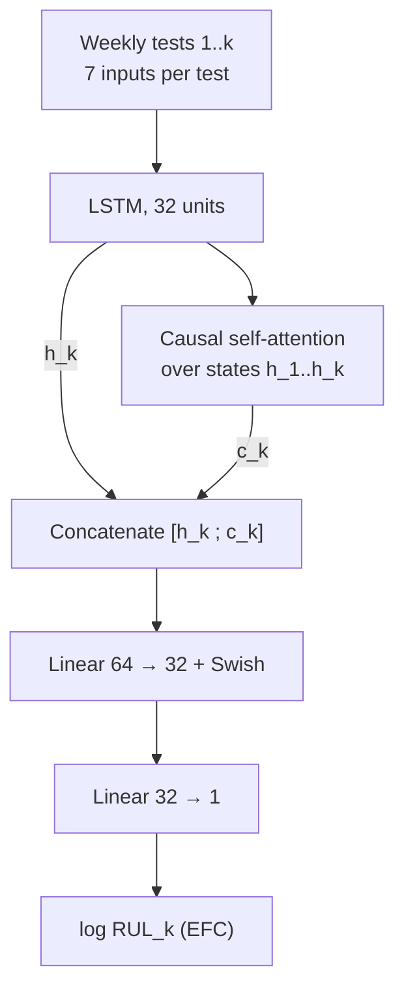

# Remaining Useful Life Prediction of Lithium-Ion Cells under Varying Usage Conditions with LSTM, Attention and Swish

**MASC 520 Final Project**

[Your Name], [Department], [University]

---

## Abstract

How long a battery lasts depends heavily on how it is used, so a lifetime model is only useful if it works for usage patterns it has not seen before. I tested this for remaining useful life (RUL) prediction on the ISU-ILCC dataset, in which 245 lithium-polymer cells were cycled under 63 combinations of charge rate, discharge rate and depth of discharge. From the raw cycling records I built a table of 3,956 weekly capacity tests, each labelled with the RUL in equivalent full cycles (EFC). The main model is an LSTM that reads the tests in order, followed by a causal self-attention layer and a Swish-activated output head. Every model was tested only on experimental groups left out of training. The LSTM reached a mean absolute error of 147.4 EFC, or 140.4 EFC when five training runs were averaged. That is well below the 203.0 EFC of a random forest that only knows the usage conditions, but slightly worse than the 137.7 EFC of a random forest given the same inputs. Removing attention or replacing Swish with ReLU changed the error by less than the variation between training runs, and no model predicted well in the first 20% of a cell's life. To make that uncertainty visible, I also trained a quantile version of the LSTM. Its 10–90% range contained the true RUL for 73% of held-out tests and narrowed from about 665 EFC early in life to 88 EFC near the end, while the spread between training runs covered only 33%.

**Index Terms:** lithium-ion battery, remaining useful life, LSTM, attention, Swish, deep learning

---

## I. Introduction

Every charge and discharge wears a lithium-ion battery down a little. A battery is usually called worn out once its capacity drops to 80% of the rated value, and the remaining useful life (RUL) is how much use is left before that happens. For a phone or laptop owner, RUL decides when to replace the battery. For a manufacturer, it shows how much a usage pattern shortens battery life.

I started this project with my own laptop in mind. Its Windows battery report showed 100.8% of design capacity after 125 cycles, so there was no fade curve to extend. To say anything about its lifetime, I needed a model trained on cells that had already worn out under a range of usage conditions.

LSTM networks [1] are the usual tool for this, because capacity measurements arrive as a sequence [2], [3]. Most of that work, though, uses the NASA or CALCE datasets, where all cells share one or a few test conditions [4], [5]. A model can do well there simply by recognizing the condition. I wanted to know what happens when it cannot. If the test cells come from conditions absent from training, does an LSTM beat simpler models that get the same information, and do attention and Swish help?

To answer this, I turned the raw records of 245 cells into a per-test RUL dataset, trained the LSTM with and without attention and Swish, and compared it with two random forests. All models were evaluated with cross-validation that always holds out whole experimental groups. Because early predictions turned out to be poor, I also added a prediction range and checked how often it actually contains the true value.

## II. Related Work

RUL prediction methods are usually divided into model-based and data-driven approaches [4]. On the data-driven side, Liu *et al.* applied an LSTM to the CALCE datasets [2], and a comparison of a simple RNN, a GRU and an LSTM on the NASA dataset found the LSTM most accurate [3]. Later studies combine the LSTM with other components. Chen *et al.* add an attention mechanism (CA-LSTM) [4], and Tran *et al.* combine 1-D convolution, an attentional LSTM and an ODE-based LSTM [5]. Tran *et al.* also point out that some earlier methods were evaluated on as few as four cells discharged at constant current.

Another line of work predicts lifetime from features measured early in life. Severson *et al.* predicted cycle life from how the discharge voltage curve changed over the first 100 cycles [6]. Li *et al.* created the ISU-ILCC dataset used here, varying charge rate, discharge rate and depth of discharge on purpose, and used it to predict lifetime under varying usage from early aging data [7], [8].

My model follows the common LSTM approach and adds the attention mechanism of [9] and the Swish activation of [10]. What differs is the evaluation: unseen usage conditions, and baselines that receive exactly the same inputs.

## III. Data and Assumptions

### A. Dataset

The ISU-ILCC dataset [8] contains 251 lithium-polymer cells (NMC cathode, graphite anode, 250 mAh rated capacity, 3.0–4.2 V) cycled at 30 °C. Each of its 63 experimental groups has its own charge rate, discharge rate and depth of discharge (DoD), with up to four cells per group. After every week of cycling, a reference performance test (RPT) measured the full capacity at C/5, and testing continued until the capacity fell below 80% of the rated value. I excluded six cells that never reached that point or had missing records. Table I summarizes the rest.

**Table I. Dataset used in this project**

| Item | Value |
| --- | --- |
| Cells / experimental groups | 245 / 63 |
| Weekly capacity tests (rows) | 3,956 |
| Tests per cell, median (range) | 14 (2–59) |
| Total life, EFC, median (range) | 784 (85–1,939) |
| Charge rate | 0.50–3.01C |
| Discharge rate | 0.49–2.48C |
| Depth of discharge | 3.5–99.5% |
| Initial capacity, mean | 113.4% of rated |

### B. Labels

A cycle does not mean the same thing across conditions. A cell cycled at 4% DoD ran more than 60,000 cycles, while one at 97% ran a few hundred. I therefore measured usage in *equivalent full cycles* (EFC): the cumulative discharged capacity divided by the rated capacity $Q_r = 0.25$ Ah,

$$
\mathrm{EFC}_k = \frac{1}{Q_r}\sum_{j \in \mathcal{C}_k} q_j
$$

where $\mathcal{C}_k$ is the set of cycles that started before test $k$ and $q_j$ is the capacity discharged in cycle $j$. If test $k$ is the first with capacity $C_k$ below $0.8\,Q_r = 0.2$ Ah, the end of life (EOL) lies between tests $k-1$ and $k$, and I interpolate it:

$$
\mathrm{EFC}_{\mathrm{EOL}} = \mathrm{EFC}_{k-1} + \frac{C_{k-1} - 0.2}{C_{k-1} - C_k}\left(\mathrm{EFC}_k - \mathrm{EFC}_{k-1}\right)
$$

The label at every earlier test is then $\mathrm{RUL}_k = \mathrm{EFC}_{\mathrm{EOL}} - \mathrm{EFC}_k$.

I computed the usage conditions from the raw current records instead of copying them from the documentation. Charging is constant-current then constant-voltage, so the charge rate is the maximum charge current over the first 30 cycles divided by 0.25 A. The discharge rate is the median discharge current over the same cycles divided by 0.25 A. The DoD is the median discharged capacity of the first 10 cycles divided by the first measured capacity. For three cells I checked by hand (G1C1, G26C1, G36C4), these values matched the documented conditions.

### C. Assumptions

1. **End of life** is the first time the C/5 capacity falls below 80% of rated capacity, a common threshold in battery studies.
2. **Capacity changes linearly** between two weekly tests. This is only used to interpolate the end of life.
3. **Usage conditions are constant** over a cell's life and can be read from its first cycles. This is not strictly true. Discharge ends at a fixed voltage, so an aging cell delivers less per cycle: G1C1 delivered 0.070 Ah in its first cycle but 0.048 Ah at the median. I use the initial DoD because it is known in advance.
4. **Cells in the same group are interchangeable**, so test cells must come from groups that are absent from training.
5. **EFC is the measure of life.** The lab cycled cells continuously, so calendar aging is not captured, and turning EFC into time requires a usage rate.
6. **Missing per-cycle capacities** are filled with the cell's median value.

## IV. Methodology

### A. Problem formulation

For cell $i$ with tests $k = 1, \dots, T_i$, the model sees the sequence $\mathbf{x}_{i,1}, \dots, \mathbf{x}_{i,k}$ and predicts $\mathrm{RUL}_{i,k}$. Each test has seven inputs: the measured capacity $C_k$, $\mathrm{EFC}_k$, the capacity lost so far $C_1 - C_k$, the recent fade slope

$$
s_k = \frac{C_k - C_{k-2}}{\mathrm{EFC}_k - \mathrm{EFC}_{k-2}} \quad (s_1 = s_2 = 0)
$$

and the three usage conditions. Inputs are standardized with training statistics. RUL ranges over more than an order of magnitude, so the target is $y_k = \log \max(\mathrm{RUL}_k, 10)$. The floor of 10 keeps the last test before EOL from dominating the loss.

### B. Model

An LSTM with 32 hidden units reads the tests in order, so its state $\mathbf{h}_k$ depends only on tests up to $k$. A single-head self-attention layer [9] then lets each step look back over all earlier states:

$$
\alpha_{kj} = \mathrm{softmax}_{j \le k}\left(\frac{(W_Q\mathbf{h}_k)^{\top} W_K\mathbf{h}_j}{\sqrt{d}}\right), \qquad
\mathbf{c}_k = W_O \sum_{j \le k} \alpha_{kj} W_V \mathbf{h}_j
$$

A causal mask enforces $j \le k$, so no prediction uses future tests. The output head maps the combined state to the log RUL,

$$
\hat{y}_k = \mathbf{w}_2^{\top}\,\mathrm{swish}\left(W_1[\mathbf{h}_k;\mathbf{c}_k] + \mathbf{b}_1\right) + b_2
$$

with $\mathrm{swish}(z) = z\,\sigma(z)$ [10]. Swish is smooth and lets small negative values through, unlike ReLU (Fig. 8). The full model has 11,585 trainable parameters, and 6,337 without attention.

**Fig. 1. Model.** The "LSTM + Swish" variant drops the attention branch, and the "attention + ReLU" variant replaces Swish with ReLU.



### C. Training

The loss is the mean squared error of $\hat{y}_k$ over the real (unpadded) steps. I used Adam [11] with a learning rate of $3\times10^{-3}$, weight decay $10^{-4}$ and mini-batches of 32 cells, and initialized the output bias to the mean target. Training uses early stopping: 20% of the training groups are held out, the validation MAE is checked every two epochs, and training stops after 20 epochs without improvement (120 at most), keeping the best weights. Section V-C explains why this turned out to matter.

### D. Baselines

Two random forests [12] (300 trees, at least two samples per leaf) are trained on the same folds:

- **Conditions only** predicts the log total life from the three usage conditions. The RUL is the predicted total minus $\mathrm{EFC}_k$. This model never sees the cell's capacity.
- **Fade features** gets the same seven inputs as the deep models at each test, but not the sequence. Capacity lost and fade slope give it a summary of the history.

### E. Prediction intervals

A single predicted value says nothing about how far off it might be. I compared two ways of attaching a range to each prediction:

- **Spread of training runs**: the lowest and highest of the five LSTM runs' predictions.
- **Quantile LSTM**: the same network with three outputs instead of one, trained to predict the 10th, 50th and 90th percentiles $\hat{y}^{(\tau)}$ of the log RUL with the pinball loss

$$
L_\tau = \max\left(\tau\,(y - \hat{y}^{(\tau)}),\ (\tau - 1)\,(y - \hat{y}^{(\tau)})\right), \qquad \tau \in \{0.1, 0.5, 0.9\}
$$

Under this loss, predicting too low costs nine times more than predicting too high for $\tau = 0.9$, which pushes that output toward the 90th percentile. The 10–90% range should therefore contain the true RUL 80% of the time. Training, early stopping and folds are the same as for the other deep models, and the five runs' percentiles are averaged. The share of held-out tests whose true RUL falls inside a range is its *coverage*.

### F. Evaluation

All models are evaluated with five-fold `GroupKFold` by experimental group, so every prediction is for a condition the model was not trained on. Each deep model is trained five times from different random seeds. I report MAE and root mean squared error (RMSE) in EFC, and the median relative error $|\hat{r}-r|/r$. The ensemble MAE is the error of the average of the five runs' predictions. I also break the error down by the share of life already used, $\mathrm{EFC}_k / \mathrm{EFC}_{\mathrm{EOL}}$. Three deep variants are compared: LSTM + Swish (no attention), LSTM + attention + ReLU, and LSTM + attention + Swish.

## V. Results

### A. Model comparison

Table II shows the results. The biggest improvement comes from letting a model see the capacity history at all: the error falls from 203.0 EFC for the conditions-only forest to 137.7–149.4 EFC for the other models. Among those, the random forest on fade features is the most accurate single model. The best deep model, LSTM + attention + Swish, reaches 147.4 EFC, or 140.4 EFC when its five runs are averaged.

**Table II. RUL prediction error on unseen experimental groups (EFC)**

| Model | MAE | Seed std | Ensemble MAE | RMSE | Median error |
| --- | --- | --- | --- | --- | --- |
| RF, conditions only | 203.0 | – | – | 270.6 | 40.1% |
| RF, fade features | **137.7** | – | – | 211.8 | **22.7%** |
| LSTM + Swish | 149.4 | 3.7 | 142.6 | 227.4 | 25.5% |
| LSTM + attention + ReLU | 147.8 | 5.4 | 140.7 | 225.8 | 24.8% |
| LSTM + attention + Swish | 147.4 | 4.6 | 140.4 | 220.8 | 25.5% |

Deep models: mean over five runs; ensemble = average of the five runs' predictions.

The three deep variants are within 2.0 EFC of each other, while the same model trained from different random seeds varies by 3.7–5.4 EFC. The data cannot tell them apart. Fig. 6 in the appendix plots predicted against true RUL for the best model, and Fig. 5 follows four held-out cells through their life.

### B. Error over the life of a cell

Fig. 2 breaks the error down by how much of its life a cell has already used. In the first 20%, every model is off by 218–226 EFC, and reading the capacity history gives no advantage over knowing the conditions alone. After that, the models that see the history improve steadily, down to 32–40 EFC in the last 20% of life. The conditions-only forest stays around 211–237 EFC until the final stage. Counted in weeks, the LSTM's median error fell below 15% of a cell's total life only after about six weekly tests.


**Fig. 2.** MAE of predicted RUL by the share of life already used. Deep models are shown as five-run ensembles.

### C. Effect of the training procedure

Getting the LSTM to this point took more work on training than on architecture. My first version (LSTM + Swish without attention, five inputs, full-batch training for 300 epochs) scored 159.1 EFC, clearly behind the random forest. I assumed it was undertrained and ran it for 800 epochs with a higher learning rate ($10^{-2}$) and a cosine schedule. The error went up to 199.3 EFC. The model was fitting the training conditions better and the new ones worse.

What helped was close to the opposite of training longer: mini-batches, early stopping on held-out groups, and two extra inputs (capacity lost and fade slope). These changes brought the same architecture to 149.4 EFC. That 9.7 EFC gain is larger than anything attention or Swish produced. Fig. 7 in the appendix shows the validation curves used for early stopping.

### D. Prediction intervals

Table III compares the two ranges. The spread between training runs is narrow and contains the true RUL only 33% of the time: the five runs agree with each other much more than they agree with reality. The quantile LSTM's 10–90% range is wider and contains the true RUL 73% of the time, a little short of the intended 80%. Its width follows the error pattern in Fig. 2, from about 665 EFC in the first 20% of life down to 88 EFC in the last 20%. Its median prediction has an MAE of 141.5 EFC, about the same as the five-run ensemble of the point model.

**Table III. Coverage and median width of the prediction ranges on held-out groups**

| Share of life used | Run spread: coverage | Run spread: width (EFC) | Quantile 10–90%: coverage | Quantile 10–90%: width (EFC) |
| --- | --- | --- | --- | --- |
| All | 32.6% | 106 | 73.2% | 362 |
| 0–20% | 27.6% | 151 | 76.4% | 665 |
| 20–40% | 31.3% | 152 | 74.4% | 493 |
| 40–60% | 34.6% | 134 | 72.6% | 371 |
| 60–80% | 33.6% | 98 | 73.5% | 253 |
| 80–100% | 37.1% | 37 | 68.8% | 88 |

Fig. 3 shows the range for the same four held-out cells as Fig. 5. For three of them the true RUL stays mostly inside the range. G63C4, the cell that outlived its group, stays above the range for most of its life.


**Fig. 3.** Median prediction and 10–90% range of the quantile LSTM for four held-out cells.

## VI. Observations and Discussion

Whether a model reads the capacity history matters far more than which model reads it. All models that saw the history ended up within about 12 EFC of each other, and all of them beat the conditions-only forest by 54–65 EFC.

I think the LSTM did not beat the random forest for two reasons. First, the dataset is small for a sequence model: 245 cells with a median of 14 tests each. Second, the inputs are thin. There is one capacity value per week, and features such as capacity lost and fade slope already summarize the history. The forest gets that summary directly, while the LSTM has to learn it from relatively few examples.

Attention and Swish made no measurable difference. With sequences this short, the LSTM state already carries the history, so looking back over earlier states adds little. And in a network of about 11,000 parameters, the choice between Swish and ReLU in a two-layer head was unlikely to matter much.

The early part of a cell's life is where every model struggles. In the first 20% of life the error is about 220 EFC, close to 28% of the median lifetime of 784 EFC. The fade curves in Fig. 4 show why. Capacity falls slowly at first and then drops sharply after a knee, and in the first few weeks a cell that will last 1,500 EFC looks much like one that will last 500.

Some cells also lived much longer than others in the same group. For G63C4 (Fig. 5), every model predicted only about half to two-thirds of its true RUL early on. Nothing in its usage conditions or early capacity set it apart, and even the quantile range missed it.

The prediction ranges taught me something I had not expected. Training the same model five times looks like a natural way to measure uncertainty, but the runs mostly disagree about details, not about the cases that are actually hard. A range has to be trained for the job, as the quantile LSTM is, and even then it covered 73% instead of 80% on unseen conditions. The early-life range of about 665 EFC is wide, but it is an honest statement of how little the first weeks reveal.

This study has limitations. I chose the training settings using the same folds that produce the reported errors, so the deep-model errors are slightly optimistic. The quantile ranges are also somewhat too narrow for unseen conditions. All cells were small 250 mAh cells tested at 30 °C with fixed currents, which may not carry over to batteries in real devices. Finally, the laptop that started the project could not be evaluated. It has no fade history yet, and its discharge rate (about 0.25C) is below the range of the data.

## VII. Conclusion

On usage conditions it had never seen, the LSTM with attention and Swish cut the error of a conditions-only model by about 27%, from 203.0 to 147.4 EFC. It did not beat a random forest given the same inputs, and neither attention nor Swish made a measurable difference. The results changed with the inputs and the training procedure, not with the architecture. A quantile version of the model gave a range that contained the true RUL 73% of the time, against 33% for the spread between training runs, and made the large early-life uncertainty explicit.

If I continued this work, I would give the sequence model richer inputs, such as the full voltage-capacity curve recorded at each weekly test, which Severson *et al.* found useful early in life [6]. Early life is also where all of the models here were weakest.

## References

[1] S. Hochreiter and J. Schmidhuber, "Long short-term memory," *Neural Computation*, vol. 9, no. 8, pp. 1735–1780, 1997.

[2] Y. Liu, G. Zhao, X. Peng, and C. Hu, "Lithium-ion battery remaining useful life prediction with long short-term memory recurrent neural network," in *Proc. Annu. Conf. PHM Society*, vol. 9, no. 1, 2017, doi: [10.36001/phmconf.2017.v9i1.2447](https://doi.org/10.36001/phmconf.2017.v9i1.2447).

[3] B. Zraibi and M. Mansouri, "Improving lithium-ion battery reliability through neural network remaining useful life prediction," *IAES Int. J. Artif. Intell.*, vol. 14, no. 1, pp. 83–91, 2025, doi: [10.11591/ijai.v14.i1.pp83-91](https://doi.org/10.11591/ijai.v14.i1.pp83-91).

[4] C. Chen, J. Wei, and Z. Li, "Remaining useful life prediction for lithium-ion batteries based on a hybrid deep learning model," *Processes*, vol. 11, no. 8, Art. no. 2333, 2023, doi: [10.3390/pr11082333](https://doi.org/10.3390/pr11082333).

[5] K. Tran, T. Le, B. Huynh, H.-C. Trinh, and V.-R. Nguyen, "End-to-end framework for predicting the remaining useful life of lithium-ion batteries," [arXiv:2505.16664](https://arxiv.org/abs/2505.16664), 2025.

[6] K. A. Severson *et al.*, "Data-driven prediction of battery cycle life before capacity degradation," *Nature Energy*, vol. 4, pp. 383–391, 2019.

[7] T. Li, Z. Zhou, A. Thelen, D. Howey, and C. Hu, "Predicting battery lifetime under varying usage conditions from early aging data," *Cell Reports Physical Science*, 2024, [arXiv:2307.08382](https://arxiv.org/abs/2307.08382).

[8] A. Thelen, T. Li, J. Liu, C. Tischer, and C. Hu, "ISU-ILCC battery aging dataset," Iowa State University, 2023, doi: [10.25380/iastate.22582234](https://doi.org/10.25380/iastate.22582234).

[9] A. Vaswani *et al.*, "Attention is all you need," in *Advances in Neural Information Processing Systems*, vol. 30, 2017.

[10] P. Ramachandran, B. Zoph, and Q. V. Le, "Searching for activation functions," [arXiv:1710.05941](https://arxiv.org/abs/1710.05941), 2017.

[11] D. P. Kingma and J. Ba, "Adam: A method for stochastic optimization," in *Proc. Int. Conf. Learning Representations (ICLR)*, 2015.

[12] L. Breiman, "Random forests," *Machine Learning*, vol. 45, no. 1, pp. 5–32, 2001.

---

## Appendix A. Additional Figures


**Fig. 4.** Capacity against equivalent full cycles for every cell, colored by depth of discharge. The dashed line marks the end of life (200 mAh).


**Fig. 5.** True and predicted RUL over the life of four held-out cells, chosen across the range of lifetimes.


**Fig. 6.** Predicted against true RUL for the LSTM + attention + Swish ensemble on held-out groups. Color shows the share of life already used.


**Fig. 7.** Validation MAE on the held-out training groups of the first fold during training. Dots mark the epochs kept by early stopping.


**Fig. 8.** The Swish and ReLU activation functions.

## Appendix B. Code

All code is in this repository. [`01_build_dataset.ipynb`](01_build_dataset.ipynb) builds the dataset from the raw records, and [`02_train_models.ipynb`](02_train_models.ipynb) trains and evaluates all models. The excerpts below show the model and the training loop.

### B.1 Model

```python
class RULNet(nn.Module):
    def __init__(self, n_features, hidden=32, attention=True, activation='swish'):
        super().__init__()
        act = nn.SiLU() if activation == 'swish' else nn.ReLU()            # nn.SiLU is Swish
        self.lstm = nn.LSTM(n_features, hidden, batch_first=True)
        self.attention = nn.MultiheadAttention(hidden, num_heads=1, batch_first=True) if attention else None
        self.head = nn.Sequential(nn.Linear(hidden * (2 if attention else 1), 32), act, nn.Linear(32, 1))

    def forward(self, x, padding, return_weights=False):
        states, _ = self.lstm(x)                                           # (cells, steps, hidden)
        weights = None
        if self.attention is not None:
            t = x.shape[1]
            future = torch.triu(torch.ones(t, t, dtype=torch.bool, device=x.device), diagonal=1)
            context, weights = self.attention(states, states, states, attn_mask=future, key_padding_mask=padding)
            states = torch.cat([states, context], dim=-1)                  # current state + attended history
        out = self.head(states).squeeze(-1)                                # log(RUL) at every step
        return (out, weights) if return_weights else out
```

### B.2 Training with early stopping (one fold)

```python
BATCH, LR, MAX_EPOCHS, PATIENCE, CHECK_EVERY = 32, 3e-3, 120, 20, 2

model = RULNet(len(FEATURES), attention=attention, activation=activation)
with torch.no_grad():
    model.head[-1].bias.fill_(float(Y[fit][M[fit]].mean()))         # start at the mean target
optimizer = torch.optim.Adam(model.parameters(), lr=LR, weight_decay=1e-4)

best_error, best_epoch, best_state = np.inf, 0, None
for epoch in range(1, MAX_EPOCHS + 1):
    model.train()
    order = torch.randperm(len(x))
    for start in range(0, len(x), BATCH):
        b = order[start:start + BATCH]
        optimizer.zero_grad()
        loss = ((model(x[b], ~m[b]) - y[b])[m[b]] ** 2).mean()         # padded steps are excluded
        loss.backward()
        optimizer.step()
    if epoch % CHECK_EVERY == 0:                                       # validate on held-out training groups
        model.eval()
        with torch.no_grad():
            pred_val = np.exp(model(x_val, pad_val).numpy())
        error = np.abs(pred_val - RUL[val])[M[val]].mean()
        if error < best_error:
            best_error, best_epoch = error, epoch
            best_state = {k: v.clone() for k, v in model.state_dict().items()}
        elif epoch - best_epoch >= PATIENCE:
            break
model.load_state_dict(best_state)
```

### B.3 Cross-validation by experimental group

```python
cv = GroupKFold(n_splits=5)
FOLDS = list(cv.split(cell_ids, groups=cell_group))   # a group is never split between training and test
```
