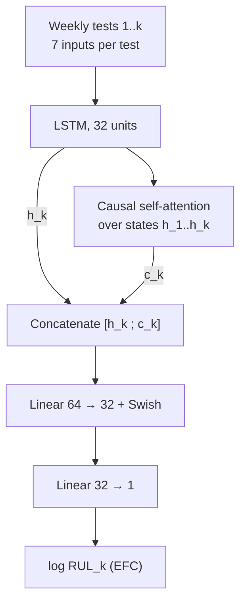
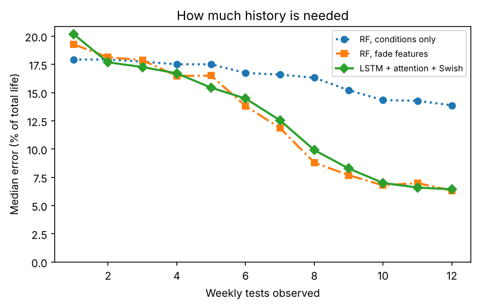

# Remaining Useful Life Prediction of Lithium-Ion Cells under Varying Usage Conditions with LSTM, Attention and Swish

**MASC 520 Final Project**

[Your Name], [Department], [University]

---

## Abstract

Predicting the remaining useful life (RUL) of lithium-ion cells is needed to plan battery maintenance and replacement. This project asks whether a recurrent deep learning model improves RUL prediction when the cells to be predicted were cycled under usage conditions that the model has never seen. From the raw records of the ISU-ILCC battery aging dataset (245 lithium-polymer cells, 63 combinations of charge rate, discharge rate and depth of discharge), I built a dataset of 3,956 weekly capacity tests labelled with RUL in equivalent full cycles (EFC). An LSTM with causal self-attention and a Swish-activated output head was trained on the sequence of tests and evaluated with five-fold cross-validation grouped by experimental condition. It reached a mean absolute error (MAE) of 147.4 EFC, or 140.4 EFC as a five-model ensemble, against 203.0 EFC for a random forest that sees only the usage conditions and 137.7 EFC for a random forest on hand-crafted fade features. Attention and Swish gave no gain beyond the spread between random initializations, and the median error fell to 15% of a cell's total life only after six weekly tests.

**Index Terms:** lithium-ion battery, remaining useful life, LSTM, attention, Swish, deep learning

---

## I. Introduction

Lithium-ion batteries power phones, laptops and electric vehicles, and every charge-discharge cycle removes a little of their capacity. A battery is usually considered worn out when its capacity falls to 80% of the rated value. The remaining useful life (RUL), the amount of use left before that point, tells a user when to replace a battery and tells a manufacturer how a usage pattern shortens it.

This project began with my own laptop. Its Windows battery report showed a full-charge capacity of 100.8% of the design capacity after 125 cycles. The battery had not started to fade, so its own history could not be extrapolated to a lifetime. Predicting its life requires a model that has learned from cells that have already aged, under usage conditions that vary in the way real use does.

Long short-term memory (LSTM) networks [1] are a common choice for this task because capacity measurements form a sequence [2], [3]. Many studies, however, train and test on small datasets such as NASA and CALCE, in which all cells were cycled under one or a few conditions [4], [5]. A model can then perform well by recognizing the condition rather than by reading the cell's state. This project therefore asks a narrower question: *when the test cells come from usage conditions not seen in training, does an LSTM, and do the attention and Swish additions, predict RUL better than simpler models given the same information?*

The contributions are:

- a per-test RUL dataset derived from the raw cycling records of 245 cells, with RUL measured in equivalent full cycles so that cells cycled at different depths can be compared;
- an LSTM with causal self-attention and a Swish head, evaluated with cross-validation grouped by experimental condition and five random initializations, against two random-forest baselines;
- an ablation of attention and Swish, and an analysis of how many weekly tests are needed before the prediction becomes useful.

## II. Related Work

RUL prediction methods are broadly model-based or data-driven [4]. Among data-driven methods, LSTM networks were applied to the CALCE datasets by Liu *et al.* [2], and a comparison of a simple RNN, a GRU and an LSTM on the NASA dataset found the LSTM most accurate [3]. Later work combines the LSTM with convolution and attention: Chen *et al.* add an attention mechanism to an LSTM (CA-LSTM) [4], and Tran *et al.* build a hybrid of 1-D convolution, attentional LSTM and ODE-based LSTM [5]. Tran *et al.* also note that some earlier methods were evaluated on as few as four cells discharged at constant current.

A different line of work predicts lifetime from early-life features. Severson *et al.* predicted cycle life from the change in the discharge voltage curve over the first 100 cycles [6]. Li *et al.* built the ISU-ILCC dataset used here, in which charge rate, discharge rate and depth of discharge were varied systematically, to predict lifetime under varying usage from early aging data [7], [8].

This project uses the common LSTM approach, adds the attention mechanism of [9] and the Swish activation of [10], and evaluates them on unseen usage conditions with non-deep baselines that receive the same inputs.

## III. Data and Assumptions

### A. Dataset

The ISU-ILCC dataset [8] contains 251 lithium-polymer cells (NMC cathode, graphite anode, 250 mAh rated capacity, 3.0–4.2 V) cycled at 30 °C. Cells were assigned to 63 experimental groups, each with its own charge rate, discharge rate and depth of discharge (DoD), and each group held up to four cells. After every week of cycling, a reference performance test (RPT) measured the full capacity at C/5. Testing continued until the capacity fell below 80% of the rated capacity. Six cells were excluded because they never reached that point or had missing records. Table I summarizes the remaining data.

**Table I. Dataset used in this project**

| Item | Value |
| --- | --- |
| Cells / experimental groups | 245 / 63 |
| Weekly capacity tests (rows) | 3,956 |
| Tests per cell, median (range) | 14 (2–59) |
| Total life, EFC, median (range) | 784 (85–1,939) |
| Charge rate | 0.50–3.01C |
| Discharge rate | 0.49–2.48C |
| Depth of discharge | 3.5–99.5% |
| Initial capacity, mean | 113.4% of rated |

### B. Labels

One cycle means very different amounts of use across conditions: a cell cycled at 4% DoD ran more than 60,000 cycles, while one at 97% ran a few hundred. Usage is therefore measured in *equivalent full cycles* (EFC), the cumulative discharged capacity divided by the rated capacity $Q_r = 0.25$ Ah:

$$
\mathrm{EFC}_k = \frac{1}{Q_r}\sum_{j \in \mathcal{C}_k} q_j
$$

where $\mathcal{C}_k$ is the set of cycles that started before test $k$ and $q_j$ is the capacity discharged in cycle $j$. If test $k$ is the first with capacity $C_k$ below $0.8\,Q_r = 0.2$ Ah, the end of life (EOL) is interpolated between tests $k-1$ and $k$:

$$
\mathrm{EFC}_{\mathrm{EOL}} = \mathrm{EFC}_{k-1} + \frac{C_{k-1} - 0.2}{C_{k-1} - C_k}\left(\mathrm{EFC}_k - \mathrm{EFC}_{k-1}\right)
$$

and the label at every earlier test is $\mathrm{RUL}_k = \mathrm{EFC}_{\mathrm{EOL}} - \mathrm{EFC}_k$.

The usage conditions were computed from the raw current records rather than copied from the dataset documentation. The charge rate is the maximum charge current over the first 30 cycles divided by 0.25 A, since charging is constant-current then constant-voltage. The discharge rate is the median discharge current over the same cycles divided by 0.25 A. The DoD is the median discharged capacity of the first 10 cycles divided by the first measured capacity. For three cells checked by hand (G1C1, G26C1, G36C4) these values agreed with the documented conditions.

### C. Assumptions

1. **End of life** is the first time the C/5 capacity falls below 80% of rated capacity, a common threshold in battery studies.
2. **Capacity changes linearly** between two weekly tests, which is used to interpolate the end of life.
3. **Usage conditions are constant** over a cell's life and are characterized by its first cycles. In practice the delivered capacity per cycle shrinks as a cell ages, because discharge ends at a fixed voltage; cell G1C1 delivered 0.070 Ah in its first cycle but 0.048 Ah at the median. The initial DoD is used because it is known in advance.
4. **Cells in a group are exchangeable**, so test cells must come from groups that are absent from training.
5. **EFC is the measure of life.** Calendar aging is not captured, since the lab cycled cells continuously, and converting EFC to time requires a usage rate.
6. **Missing per-cycle capacities** are replaced by the cell's median value.

## IV. Methodology

### A. Problem formulation

For cell $i$ with tests $k = 1, \dots, T_i$, the model receives the sequence $\mathbf{x}_{i,1}, \dots, \mathbf{x}_{i,k}$ and predicts $\mathrm{RUL}_{i,k}$. Each test has seven inputs: the measured capacity $C_k$, $\mathrm{EFC}_k$, the capacity lost so far $C_1 - C_k$, the recent fade slope

$$
s_k = \frac{C_k - C_{k-2}}{\mathrm{EFC}_k - \mathrm{EFC}_{k-2}} \quad (s_1 = s_2 = 0)
$$

and the three usage conditions. Inputs are standardized with training statistics. Because RUL spans more than an order of magnitude, the target is $y_k = \log \max(\mathrm{RUL}_k, 10)$; the floor keeps the last test before EOL from dominating the loss.

### B. Model

An LSTM with 32 hidden units reads the tests in order, so its state $\mathbf{h}_k$ depends only on tests up to $k$. A single-head self-attention layer [9] then lets each step weigh all earlier states:

$$
\alpha_{kj} = \operatorname{softmax}_{j \le k}\left(\frac{(W_Q\mathbf{h}_k)^{\top} W_K\mathbf{h}_j}{\sqrt{d}}\right), \qquad
\mathbf{c}_k = W_O \sum_{j \le k} \alpha_{kj} W_V \mathbf{h}_j
$$

A causal mask enforces $j \le k$, so no prediction uses future tests. The head maps the concatenated state to the log RUL,

$$
\hat{y}_k = \mathbf{w}_2^{\top}\,\mathrm{swish}\left(W_1[\mathbf{h}_k;\mathbf{c}_k] + \mathbf{b}_1\right) + b_2
$$

with $\mathrm{swish}(z) = z\,\sigma(z)$ [10]. Unlike ReLU, Swish is smooth and passes small negative values (Fig. 8). The model has 11,585 trainable parameters, or 6,337 without attention.

**Fig. 1. Model.** The attention branch is removed in the "LSTM + Swish" variant, and Swish is replaced by ReLU in the "attention + ReLU" variant.



### C. Training

The loss is the mean squared error of $\hat{y}_k$ over the real (unpadded) steps of all sequences. Training uses Adam [11] with a learning rate of $3\times10^{-3}$, weight decay $10^{-4}$ and mini-batches of 32 cells, and the output bias is initialized to the mean target. A first version trained on the full batch for a fixed number of epochs overfitted to the training conditions. Early stopping was therefore added: 20% of the training groups are held out, the validation MAE is checked every two epochs, and training stops after 20 epochs without improvement (at most 120), restoring the best weights.

### D. Baselines

Two random forests [12] with 300 trees and a minimum of two samples per leaf are trained on the same folds:

- **Conditions only** predicts the log total life from the three usage conditions; the RUL is the predicted total minus $\mathrm{EFC}_k$. It never sees the cell's capacity.
- **Fade features** receives the same seven inputs as the deep models at each test, but no sequence. The capacity lost and fade slope give it a summary of the history.

### E. Evaluation

All models are evaluated with five-fold `GroupKFold` by experimental group, so every prediction is for a condition absent from training. Each deep model is trained with five random seeds. The metrics are MAE and root mean squared error (RMSE) in EFC and the median relative error $|\hat{r}-r|/r$. The ensemble MAE is computed after averaging the five seeds' predictions. Errors are also broken down by the share of life used, $\mathrm{EFC}_k / \mathrm{EFC}_{\mathrm{EOL}}$, and by the number of tests observed. Three deep variants are compared: LSTM + Swish (no attention), LSTM + attention + ReLU, and LSTM + attention + Swish.

## V. Results

### A. Model comparison

Table II lists the results. Seeing the capacity history reduces the MAE from 203.0 EFC (conditions only) to between 137.7 and 149.4 EFC. The random forest on fade features has the lowest single-model error, 137.7 EFC. The best deep model, LSTM + attention + Swish, reaches 147.4 EFC and 140.4 EFC as an ensemble.

**Table II. RUL prediction error on unseen experimental groups (EFC)**

| Model | MAE | Seed std | Ensemble MAE | RMSE | Median error |
| --- | --- | --- | --- | --- | --- |
| RF, conditions only | 203.0 | – | – | 270.6 | 40.1% |
| RF, fade features | **137.7** | – | – | 211.8 | **22.7%** |
| LSTM + Swish | 149.4 | 3.7 | 142.6 | 227.4 | 25.5% |
| LSTM + attention + ReLU | 147.8 | 5.4 | 140.7 | 225.8 | 24.8% |
| LSTM + attention + Swish | 147.4 | 4.6 | 140.4 | 220.8 | 25.5% |

Deep models: mean over five seeds; ensemble = average of the five seeds' predictions.

The three deep variants differ by at most 2.0 EFC in MAE, while the standard deviation across seeds is 3.7 to 5.4 EFC. Neither attention nor Swish therefore produces a measurable improvement. Fig. 5 in the appendix shows predicted against true RUL for the best model, and Fig. 4 follows four held-out cells over their life.

### B. Error over the life of a cell

Fig. 2 shows the MAE by the share of life already used. In the first 20% of life, all models have an MAE of 218–226 EFC, and the models that read the capacity history are no better than the conditions-only model. From 20% of life onward their error falls steadily, to 32–40 EFC in the last 20%, while the conditions-only model stays near 211–237 EFC until the last stage.


**Fig. 2.** MAE of predicted RUL by the share of life already used. Deep models are shown as five-seed ensembles.

### C. How many weekly tests are needed

Table III gives the median error as a share of each cell's total life, by the number of tests observed. The LSTM's median error stays at or below 15% of total life from six tests onward and at or below 10% from eight tests. With fewer than four tests it is no better than the conditions-only model. The random forest on fade features follows almost the same curve.

**Table III. Median error (% of total life) by weekly tests observed**

| Tests observed | 1 | 2 | 4 | 6 | 8 | 10 | 12 |
| --- | --- | --- | --- | --- | --- | --- | --- |
| Cells still alive | 245 | 245 | 240 | 234 | 226 | 200 | 163 |
| RF, conditions only | 17.9 | 17.9 | 17.5 | 16.7 | 16.3 | 14.3 | 13.9 |
| RF, fade features | 19.3 | 18.1 | 16.5 | 13.8 | 8.8 | 6.8 | 6.3 |
| LSTM + attention + Swish | 20.2 | 17.7 | 16.7 | 14.5 | 9.9 | 7.0 | 6.4 |

### D. Effect of the training procedure

The training procedure mattered more than the architecture. The first version of the model (LSTM + Swish without attention, the five inputs without the two fade features, full-batch training for a fixed 300 epochs, three seeds) reached an MAE of 159.1 EFC. Training it for 800 epochs with a learning rate of $10^{-2}$ and a cosine schedule raised the error to 199.3 EFC: the model fitted the training conditions better and the unseen conditions worse. Adding the fade features, mini-batches and early stopping on held-out groups brought the same architecture to 149.4 EFC. This gain of 9.7 EFC is larger than any difference between the deep variants. Fig. 7 in the appendix shows the validation curves used for early stopping.

## VI. Observations and Discussion

**The capacity history carries most of the information.** The largest improvement in the study, from 203 to about 140 EFC, comes from letting a model see the measured capacity, whichever model does so.

**The deep models matched the random forest but did not beat it.** Two factors likely explain this. The dataset is small for sequence models: 245 cells with a median of 14 tests each. In addition, every input is a scalar derived from one capacity value per week, and the hand-crafted capacity lost and fade slope already summarize the history that the LSTM must learn to summarize. With so little sequence information, a recurrent model has little to extract that the features do not already give.

**Attention and Swish added nothing measurable.** Their differences were smaller than the variation between random seeds. With sequences of a few to a few dozen steps, the LSTM state already carries the history, so attending back over earlier states adds little. The activation in a two-layer head is a minor part of such a small network.

**Early prediction is the hard part.** During the first 20% of life, all models erred by about 220 EFC, close to 28% of the median total life of 784 EFC. The fade curves (Fig. 3) show why: capacity declines slowly at first and drops sharply after a knee, and cells that will last long and cells that will fail early look alike in the first weeks. A useful prediction requires about six weekly tests.

**Same conditions, different lives.** Some cells lived much longer than others in their group. For cell G63C4 (Fig. 4), every model predicted about half to two-thirds of its true RUL early in life, because nothing in the usage conditions or the early capacity distinguished it.

**Limitations.** The training settings were chosen using the same folds that produce the reported errors, so the deep-model errors are slightly optimistic. All cells were small 250 mAh cells tested at 30 °C with fixed currents, so the results may not transfer to batteries in real devices. The laptop that motivated the project could not be evaluated: it has no fade history, and its discharge rate (about 0.25C) is below the range of the data.

## VII. Conclusion

This project built a per-test RUL dataset from the raw records of 245 lithium-polymer cells and trained an LSTM with causal self-attention and a Swish head to predict RUL on usage conditions absent from training. The model reduced the error of a conditions-only baseline by about 27%, from 203.0 to 147.4 EFC, but did not beat a random forest given the same inputs (137.7 EFC), and neither attention nor Swish gave a measurable gain. Six weekly tests were needed before the median error fell to 15% of total life.

The results suggest that, for this kind of data, the inputs limit accuracy more than the architecture does. A natural next step is to give the sequence model richer inputs, such as the full voltage-capacity curve recorded at each weekly test, which Severson *et al.* found to be informative early in life [6].

## References

[1] S. Hochreiter and J. Schmidhuber, "Long short-term memory," *Neural Computation*, vol. 9, no. 8, pp. 1735–1780, 1997.

[2] Y. Liu, G. Zhao, X. Peng, and C. Hu, "Lithium-ion battery remaining useful life prediction with long short-term memory recurrent neural network," in *Proc. Annu. Conf. PHM Society*, vol. 9, no. 1, 2017, doi: [10.36001/phmconf.2017.v9i1.2447](https://doi.org/10.36001/phmconf.2017.v9i1.2447).

[3] B. Zraibi and M. Mansouri, "Improving lithium-ion battery reliability through neural network remaining useful life prediction," *IAES Int. J. Artif. Intell.*, vol. 14, no. 1, pp. 83–91, 2025, doi: [10.11591/ijai.v14.i1.pp83-91](https://doi.org/10.11591/ijai.v14.i1.pp83-91).

[4] C. Chen, J. Wei, and Z. Li, "Remaining useful life prediction for lithium-ion batteries based on a hybrid deep learning model," *Processes*, vol. 11, no. 8, Art. no. 2333, 2023, doi: [10.3390/pr11082333](https://doi.org/10.3390/pr11082333).

[5] K. Tran, T. Le, B. Huynh, H.-C. Trinh, and V.-R. Nguyen, "End-to-end framework for predicting the remaining useful life of lithium-ion batteries," [arXiv:2505.16664](https://arxiv.org/abs/2505.16664), 2025.

[6] K. A. Severson *et al.*, "Data-driven prediction of battery cycle life before capacity degradation," *Nature Energy*, vol. 4, pp. 383–391, 2019.

[7] T. Li, Z. Zhou, A. Thelen, D. Howey, and C. Hu, "Predicting battery lifetime under varying usage conditions from early aging data," *Cell Reports Physical Science*, 2024, [arXiv:2307.08382](https://arxiv.org/abs/2307.08382).

[8] A. Thelen, T. Li, J. Liu, C. Tischer, and C. Hu, "ISU-ILCC battery aging dataset," Iowa State University, 2023, doi: [10.25380/iastate.22582234](https://doi.org/10.25380/iastate.22582234).

[9] A. Vaswani *et al.*, "Attention is all you need," in *Advances in Neural Information Processing Systems*, vol. 30, 2017.

[10] P. Ramachandran, B. Zoph, and Q. V. Le, "Searching for activation functions," [arXiv:1710.05941](https://arxiv.org/abs/1710.05941), 2017.

[11] D. P. Kingma and J. Ba, "Adam: A method for stochastic optimization," in *Proc. Int. Conf. Learning Representations (ICLR)*, 2015.

[12] L. Breiman, "Random forests," *Machine Learning*, vol. 45, no. 1, pp. 5–32, 2001.

---

## Appendix A. Additional Figures


**Fig. 3.** Capacity against equivalent full cycles for every cell, colored by depth of discharge. The dashed line marks the end of life (200 mAh).


**Fig. 4.** True and predicted RUL over the life of four held-out cells, chosen across the range of lifetimes.


**Fig. 5.** Predicted against true RUL for the LSTM + attention + Swish ensemble on held-out groups. Color shows the share of life already used.



**Fig. 6.** Median error as a share of total life against the number of weekly tests observed (values in Table III).


**Fig. 7.** Validation MAE during training on the held-out training groups of the first fold. Dots mark the epochs kept by early stopping.


**Fig. 8.** The Swish and ReLU activation functions.

## Appendix B. Code

The full code is in this repository: [`01_build_dataset.ipynb`](01_build_dataset.ipynb) builds the dataset from the raw records, and [`02_train_models.ipynb`](02_train_models.ipynb) trains and evaluates all models. The excerpts below show the model and the training loop.

### B.1 Model

```python
class RULNet(nn.Module):
    def __init__(self, n_features, hidden=32, attention=True, activation='swish'):
        super().__init__()
        act = nn.SiLU() if activation == 'swish' else nn.ReLU()            # nn.SiLU is Swish
        self.lstm = nn.LSTM(n_features, hidden, batch_first=True)
        self.attention = nn.MultiheadAttention(hidden, num_heads=1, batch_first=True) if attention else None
        self.head = nn.Sequential(nn.Linear(hidden * (2 if attention else 1), 32), act, nn.Linear(32, 1))

    def forward(self, x, padding, return_weights=False):
        states, _ = self.lstm(x)                                           # (cells, steps, hidden)
        weights = None
        if self.attention is not None:
            t = x.shape[1]
            future = torch.triu(torch.ones(t, t, dtype=torch.bool, device=x.device), diagonal=1)
            context, weights = self.attention(states, states, states, attn_mask=future, key_padding_mask=padding)
            states = torch.cat([states, context], dim=-1)                  # current state + attended history
        out = self.head(states).squeeze(-1)                                # log(RUL) at every step
        return (out, weights) if return_weights else out
```

### B.2 Training with early stopping (one fold)

```python
BATCH, LR, MAX_EPOCHS, PATIENCE, CHECK_EVERY = 32, 3e-3, 120, 20, 2

model = RULNet(len(FEATURES), attention=attention, activation=activation)
with torch.no_grad():
    model.head[-1].bias.fill_(float(Y[fit][M[fit]].mean()))         # start at the mean target
optimizer = torch.optim.Adam(model.parameters(), lr=LR, weight_decay=1e-4)

best_error, best_epoch, best_state = np.inf, 0, None
for epoch in range(1, MAX_EPOCHS + 1):
    model.train()
    order = torch.randperm(len(x))
    for start in range(0, len(x), BATCH):
        b = order[start:start + BATCH]
        optimizer.zero_grad()
        loss = ((model(x[b], ~m[b]) - y[b])[m[b]] ** 2).mean()         # padded steps are excluded
        loss.backward()
        optimizer.step()
    if epoch % CHECK_EVERY == 0:                                       # validate on held-out training groups
        model.eval()
        with torch.no_grad():
            pred_val = np.exp(model(x_val, pad_val).numpy())
        error = np.abs(pred_val - RUL[val])[M[val]].mean()
        if error < best_error:
            best_error, best_epoch = error, epoch
            best_state = {k: v.clone() for k, v in model.state_dict().items()}
        elif epoch - best_epoch >= PATIENCE:
            break
model.load_state_dict(best_state)
```

### B.3 Cross-validation by experimental group

```python
cv = GroupKFold(n_splits=5)
FOLDS = list(cv.split(cell_ids, groups=cell_group))   # a group is never split between training and test
```
